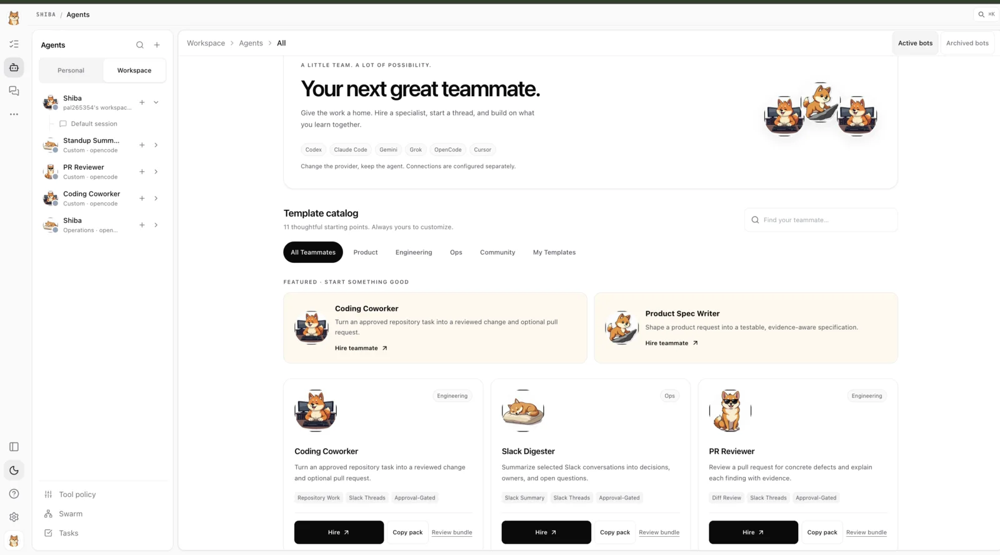
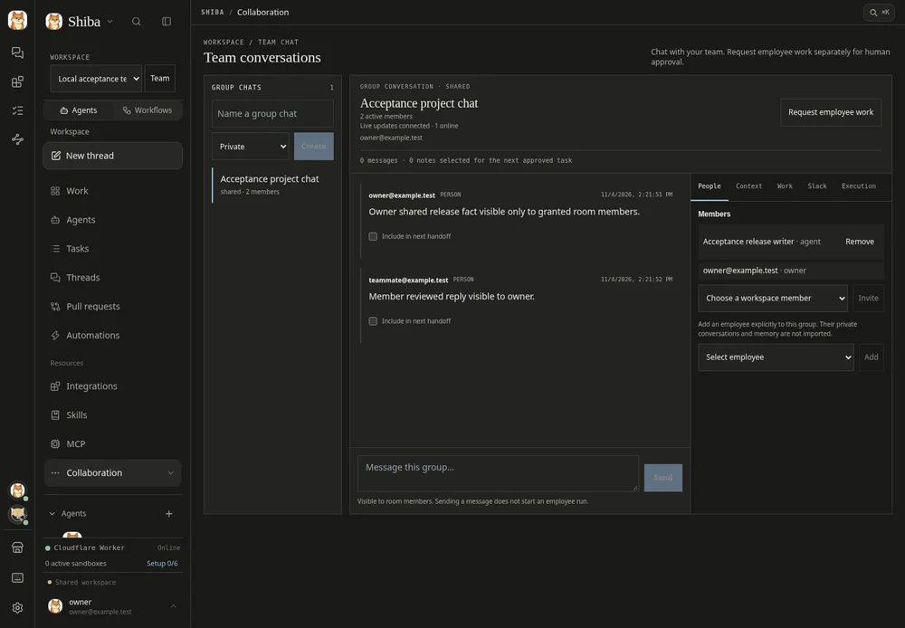
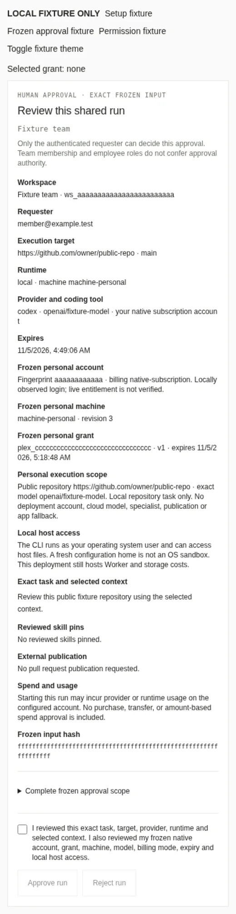

<div align="center">

# Shiba

**Approval-first AI employees for the work behind your company.**  
Hire coding, marketing, research, and operations teammates that plan, ask before acting, and return reviewable work.

<p>
<a href="https://tryshiba.dev/"><b>Website</b></a> ·
<a href="https://tryshiba.dev/docs/"><b>Docs</b></a> ·
<a href="https://app.tryshiba.dev/app/"><b>Dashboard</b></a> ·
<a href="#local-quickstart"><b>Run locally</b></a>
</p>

<sub>Open source · self-hosted · AGPL-3.0-only</sub>

</div>

<br>

<picture>
  <source media="(prefers-color-scheme: dark)" srcset="docs/readme/agents-dark.webp">
  
</picture>

## What it is

Shiba is an open-source workspace for AI employees doing company work: engineering, design, marketing, sales, operations, finance, research, and revenue planning.

Describe the outcome, review the exact proposed work, and approve it before execution. Shiba returns durable output you can inspect: a code change, campaign draft, account brief, operating checklist, research table, or budget draft using figures you supply. Publication to GitHub, Slack, email, or another external system requires separate authority.

The software is free to self-host. You pay for hosting and model usage through the providers you choose. Start with [your first task](https://tryshiba.dev/docs/getting-started/) or the [self-hosting guide](https://tryshiba.dev/docs/self-hosting/).

**Status: deployed prototype, not production-ready.** No live end-to-end cloud run is claimed. `tryshiba.dev` serves the static landing/docs site; `app.tryshiba.dev` serves the Worker dashboard and API behind Cloudflare Access. The Worker deploy proves provisioning and serving, not a live coding run. `docs/verification/verification.md` records local typecheck, lint, test, and build evidence; the backend remains a prototype until a dated run meets the P2 acceptance bar in `docs/plans/plan.md` §15. Slack's P3 acceptance bar is also still unverified against a real workspace.

## Contents

- [What employees can do](#what-employees-can-do)
- [Product tour](#product-tour)
- [How work flows](#how-work-flows)
- [Chat channels](#chat-channels)
- [Workspace credits](#workspace-credits)
- [Local quickstart](#local-quickstart)
- [Deploy](#deploy)
- [Architecture and safety](#architecture-and-safety)
- [Configuration and models](#configuration-and-models)
- [Honest implementation status](#honest-implementation-status)
- [Repository layout](#repository-layout)

## What employees can do

| | |
| --- | --- |
| **Plan before work** | A goal becomes a scoped plan with required access, deliverables, verification, cost limits, and open questions. |
| **Ask before acting** | No sandbox or employee task starts before human approval. Publication and external effects use separate approval. |
| **Work in bounded runtimes** | Repository tasks run in isolated sandboxes; approved local work can use a paired machine without widening authority. |
| **Return reviewable output** | Required files, reports, diffs, source references, and verification evidence survive refresh and restart. |
| **Collaborate in a workspace** | People and bots can share a room, assign work, and keep parent/child progress visible without merging identities or permissions. |
| **Meet people where they work** | Slack, Discord, Microsoft Teams, Telegram, email, MCP clients, and the dashboard can enter the same approval-first system with different capability levels. |
| **Use the AI you choose** | API-key, subscription, local-daemon, and ACP harness lanes are explicit; credentials stay outside execution containers. |
| **Meter usage** | Optional prepaid workspace credits debit settled run cost through an append-only ledger. |

## Product tour

<table>
<tr>
<td width="62%"></td>
<td width="38%"></td>
</tr>
<tr>
<td><sub><b>Shared workspace.</b> People and employees collaborate in explicit rooms; a chat message does not start employee work.</sub></td>
<td><sub><b>Exact approval.</b> The reviewer sees the frozen task, target, runtime, provider, scope, expiry, and cost authority before deciding.</sub></td>
</tr>
</table>

## How work flows

```text
Person or channel
  -> authenticated workspace ingress
  -> goal or task intake
  -> exact frozen human approval
  -> bounded execution lane
     repository sandbox, artifact workspace, employee app action,
     paired local machine, browser/computer session, or automation
  -> durable deliverables, provenance, and verification
  -> human review
  -> separately approved publication or external effect
```

A model response is not completion. Shiba records the plan, authority, runtime, output references, verification result, and remaining gaps so a refresh, retry, or handoff does not rewrite what happened.

## Chat channels

| Surface | Current behavior | Main gap before parity |
| --- | --- | --- |
| Slack | `/shiba`, `@shiba`, signed events/interactions, approval cards, thread continuity, progress/outcome replies, optional result files, and room mirroring. | No P3 live workspace verification is claimed. |
| Discord | `/shiba`, signed interactions, approval buttons, channel progress and outcome replies. | Narrower continuation, file-delivery, and room-integration behavior than Slack. |
| Microsoft Teams | Mention or direct-message intake, signed Bot Framework activities, Adaptive Card approval, and outcome replies. | No publication approval in Teams; reactions, history, uploads, and lookups are limited by the current adapter. |
| Dashboard | Full workspace, employees, approvals, runs, artifacts, integrations, automations, credits, and review surfaces. | Live end-to-end cloud execution remains unverified. |

Slack details: `/shiba <github-repo-url> <task>` uses `POST /api/slack/command`; mentions use `POST /api/slack/events`. Both HMAC-verify, queue a durable pending approval, and post a Block Kit card. `SLACK_APPROVERS` unset means nobody can approve from Slack. That is deliberate: a valid Slack signature authenticates Slack, not the human who clicked.

Detailed setup lives in [Slack](apps/web/src/content/docs/docs/slack.mdx), [Discord](apps/web/src/content/docs/docs/discord.mdx), and [Microsoft Teams setup](apps/web/src/content/docs/docs/teams-setup.md).

## Workspace credits

Current implementation: an installation can enable prepaid workspace credits through Stripe. Credits pay for computer time and models the deployment pays for; a person's own provider key, plan subscription, or paired computer is not charged as deployment model spend. Runs stop at zero unless the owner explicitly exempts user-funded lanes.

The roadmap adds a Viktor-style plan layer on top of that ledger: starter credits, shared workspace plan credits, rollover rules, on-demand top-ups, per-user or per-run spend caps, and enterprise billing controls. Those plan features are **not implemented yet**; the current shipped surface is prepaid top-ups and balance enforcement. See [the product roadmap](docs/plans/roadmap.md).

## Local quickstart

Requirements: Node.js **22.13.0+**, pnpm **10.0.0+**, and a running Docker engine for sandbox containers.

```sh
pnpm install
cp apps/backend/.dev.vars.example apps/backend/.dev.vars   # if missing
pnpm dev
```

- `pnpm dev` starts Wrangler on `http://127.0.0.1:8788`, OAuth loopback listeners, and Vite on `http://localhost:5173`.
- Use `pnpm shiba dev` when you also need local secrets, D1 migrations, a sandbox image build, and containers.
- In `.dev.vars`, set `GITHUB_TOKEN` scoped to the approved repository and `MODEL_CREDENTIAL_KEY` for encrypted provider tokens. Add provider sign-ins from the dashboard.
- Task flow: compose a task → approve the exact delegation card → inspect the result → separately approve publication.

Preview the setup with `pnpm shiba dev --dry-run`. Full local gate: `pnpm typecheck && pnpm lint && pnpm test && pnpm docs:check && pnpm build`.

## Deploy

### Static site

The `shiba` Cloudflare Pages project hosts the marketing site and `/docs/`:

```sh
pnpm build
pnpm exec wrangler pages deploy public --project-name shiba --branch main --commit-dirty=true
```

The Pages site does not serve the Worker API. `_redirects` sends `/app*` and `/dashboard*` to `app.tryshiba.dev` and edge-proxies `POST /api/waitlist`.

### Worker backend

One command provisions the Worker, Durable Objects, Containers, KV, R2, D1, Vectorize, Queues, Workflows, and Cloudflare Access with [Alchemy](https://alchemy.run):

```sh
pnpm install
pnpm run bootstrap
```

Re-deploy with `pnpm run deploy:alchemy`; preview with `pnpm deploy:preview`; tear down with `pnpm deploy:destroy`.

Secure-by-default deployment behavior:

- `REQUIRE_ACCESS=1` is set on live stages; without verified Access identity the dashboard and API return 401.
- `ACCESS_EMAILS`, `WORKERS_SUBDOMAIN`, and `ACCESS_AUD` configure the Access application and JWT verification.
- A second Access application bypasses machine callers that authenticate themselves: `/api/slack/events`, `/api/slack/command`, `/api/slack/interact`, `/api/github/webhook`, `/api/telegram/webhook`, `/api/discord/interactions`, `/api/teams/messages`, `/api/trigger`, `/mcp`, and `/api/automations/*/trigger`.
- Secrets come only from `.env`; Alchemy replaces Worker secrets on every deploy.
- Rollback with `npx wrangler deploy --config apps/backend/wrangler.jsonc` does not create the Access applications.

Still manual: add provider keys or subscriptions, create the Slack app from `slack-app-manifest.yaml`, configure Discord/Teams apps, and mint MCP tokens. Inbound email requires a domain on Cloudflare Email Routing.

## Architecture and safety

The pnpm monorepo contains a Cloudflare Worker backend, React dashboard, Astro docs/marketing site, shared wire contracts, sandbox runtime packages, and an Electron desktop prototype.

Core invariants:

- **Approval first.** Queueing work mints an approval; no sandbox starts before it is granted.
- **Credentials stay outside containers.** Provider tokens are attached at the Worker egress proxy; the sandbox sees a placeholder.
- **Repository scope is narrow.** `GITHUB_TOKEN` egress is refused until the exact approved `/owner/repo` scope is installed, and container pushes are refused.
- **Authority does not cascade.** A child employee or delegated bot receives no more access than its parent plan grants.
- **Publication is separate.** Creating a draft, running a task, merging a PR, posting to a channel, or sending email are distinct authority decisions.
- **Evidence beats prose.** Completion requires durable output plus verification, not a model saying it is done.

Provider traffic is intercepted at the sandbox egress boundary and forwarded through the account owner's AI Gateway or subscription lane. There is no provider callback route.

Cloudflare Containers max out at **`standard-4` (4 vCPU / 12 GiB / 20 GB)**. Heavy builds and large monorepo test suites are outside this platform's ceiling.

## Configuration and models

Important defaults:

| Setting | Default |
| --- | --- |
| `GATEWAY_ID` | `default` |
| `ORCHESTRATOR_MODEL` | `@cf/meta/llama-3.1-8b-instruct` |
| `CODING_MODEL` | `google/gemini-3.5-flash-lite` |
| `RUNTIME` | `sandbox` |
| `AGENT_HARNESS` | `opencode` |

Harness lanes include API-key lanes (`opencode`, `claude-code`, `codex`, `devin`, `grok`), Subscription lanes (`claude-subscription`, `codex-subscription`, `antigravity-subscription`, `cursor-subscription`, `devin-subscription`), and ACP lanes (`claude-acp`, `codex-acp`, `gemini-acp`, `opencode-acp`, `devin-acp`). Anthropic's terms still forbid routing Free/Pro/Max plan credentials on behalf of third-party users.

Pinned versions that couple to the run contract:

| Pin | Why |
| --- | --- |
| `opencode-ai@1.18.31` | Its JSON event shape is parsed by the OpenCode harness adapter. |
| `@cloudflare/sandbox@1.0.1` | The sandbox shim and container image are coupled to SDK 1.0 behavior. |
| `wrangler@4.140.0` | Sandbox SDK 1.0 requires `scheduling_policy: durable_object`. |
| `google/gemini-3.5-flash-lite` | Provider model ids retire without warning. |

Tokens dominate cost — roughly 20–40× Cloudflare compute — so provider choice matters more than container tuning. See [costs](apps/web/src/content/docs/docs/costs.md).

## Honest implementation status

Implemented foundations include structured delegation, exact approvals, sandbox execution machinery, per-user orchestration, deny-by-default egress, subscription credential lanes, chat-channel adapters, automations, artifact capture, workspace credits, and extensive unit/browser fixtures.

Do not read those foundations as proof of a finished AI employee workspace:

- Real sandbox container + live model + live GitHub end-to-end execution is not verified on an operator-owned Cloudflare deployment.
- Slack's P3 acceptance bar has not been exercised against a real workspace.
- ComputeSDK backends such as E2B, Daytona, and Modal are not production-verified for Shiba invariants.
- The multi-round review loop endpoint remains incomplete.
- General employee goal ownership, cross-bot delegation, artifact lineage, and role-specific semantic verification are still roadmap work.
- Cancellation is best-effort; clearing registry/history is not process cancellation or complete Durable Object erasure.
- GitHub publishing uses captured contents, not a lossless Git patch; file modes and large files need more work.

The forward-looking sequence is in [docs/plans/roadmap.md](docs/plans/roadmap.md). Historical task evidence stays in [docs/plans/plan.md](docs/plans/plan.md) and [docs/verification/verification.md](docs/verification/verification.md).

## Repository layout

```text
.
├── package.json             # private root scripts and toolchain devDependencies
├── pnpm-workspace.yaml      # workspace definition
├── turbo.json               # build/test/lint/typecheck task graph
├── alchemy.run.ts           # Cloudflare stack declaration
├── apps/
│   ├── backend/             # Cloudflare Worker, Durable Objects, sandbox control
│   ├── frontend/            # React dashboard
│   ├── web/                 # Astro marketing and documentation site
│   └── desktop/             # Electron desktop prototype
├── packages/
│   ├── shared/              # browser-safe wire contracts and schemas
│   └── sandbox/             # sandbox runtime and provider adapters
└── docs/
    ├── architecture/        # living architecture companion documents
    ├── plans/               # dated and active feature plans
    ├── product/             # product contracts
    ├── verification/        # dated verification evidence
    └── readme/              # README screenshots
```

Key entry points: [ARCHITECTURE.md](ARCHITECTURE.md), [docs/product/ai-employees.md](docs/product/ai-employees.md), [CONTRIBUTING.md](CONTRIBUTING.md), and [design.md](design.md).

## License

AGPL-3.0-only. See [LICENSE](LICENSE).
