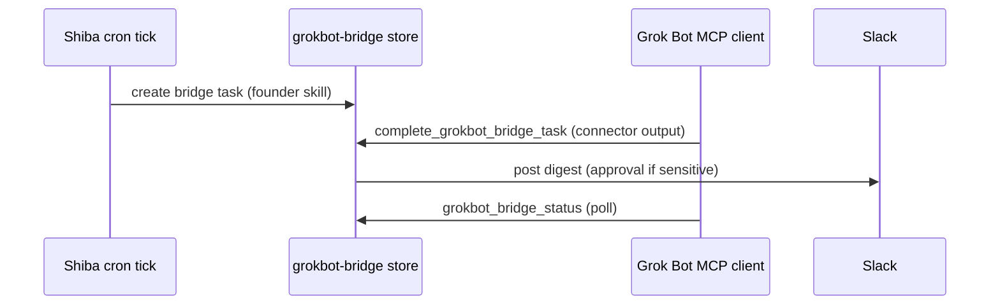

Shiba does **not** rebuild HubSpot, Stripe, Meta Ads, or other thick SaaS connectors. Those live in **Grok Bot** (SearchPlugins / connected MCP). Shiba hosts **Skills**, **Spaces**, and **scheduled tasks**, and reaches Grok Bot work through a **`grokbot-bridge` execution target** plus MCP tools on `/mcp`.

## Architecture

1. **Integrations catalog** marks SaaS rows as `grokbot-bridge` (see Integrations in the dashboard).
2. **Founder skill library** (Skills → Founder skill library) installs reviewed **drafts** and can **deploy** a schedule with `executionTarget.kind = "grokbot-bridge"`.
3. On each cron tick, Shiba creates a queued bridge task. Grok Bot supplies the connector result before Shiba posts a digest. `GROKBOT_BRIDGE_SIMULATE=true` supplies demo metrics instead. Slack posting needs `SLACK_BOT_TOKEN` and `SLACK_APPROVALS_CHANNEL` (or a per-skill channel).
4. **Grok Bot** pairs to Shiba MCP ([Use from Claude Code](/docs/mcp/)) and calls `queue_grokbot_bridge_task`, `grokbot_bridge_status`, and `complete_grokbot_bridge_task` to round-trip connector work.

## Pair Grok Bot ↔ Shiba MCP

Follow [Use from Claude Code](/docs/mcp/) to mint a `shb_…` token and register `https://<worker-host>/mcp` in Grok Bot. Grant at least:

| Scope | Tools |
| --- | --- |
| `sandbox:exec` | `queue_grokbot_bridge_task`, `complete_grokbot_bridge_task`, `queue_run` |
| `runs:read` | `grokbot_bridge_status`, `run_status`, `list_runs` |

Smoke path (code-proven in CI tests; the live Grok Bot connector UI needs your Grok Bot connector credentials):

1. `queue_grokbot_bridge_task { founderSkillId: "founder-stripe-revenue-pulse" }` → `{ taskId, status: "queued" }`
2. `grokbot_bridge_status { taskId }` → `status: "queued"` then `"completed"` after complete
3. `complete_grokbot_bridge_task { taskId, result: { … }, postSlack: true }` → digest posted when Slack secrets exist

## Founder skill pack

| Library id | Schedule | Grok Bot connectors | Sensitive Slack gate |
| --- | --- | --- | --- |
| `founder-weekly-ads-report` | Mon 09:00 PT | Google + Meta (Adspirer) | no |
| `founder-stripe-revenue-pulse` | Daily 08:00 PT | Stripe | no |
| `founder-hubspot-stripe-reconcile` | Tue 10:00 PT | HubSpot + Stripe | **yes** |
| `founder-linear-triage` | Mon 09:00 UTC | Linear (native + bridge) | no |
| `founder-pr-digest` | Fri 16:00 UTC | GitHub (native) | no |
| `founder-figma-ticket` | Wed 11:00 PT | Figma + Linear | no |

API: `GET /api/founder-skills`, `POST /api/founder-skills/:id/install`, `POST /api/founder-skills/:id/deploy`.

## Live vs blocked (operator checklist)

| Step | Code-proven | Live-blocked without |
| --- | --- | --- |
| Library renders + install draft | ✅ dashboard + API tests | signed-in dashboard |
| Deploy cron automation | ✅ API + automations validation | `CodingOrchestrator` DO |
| Revenue pulse Slack on cron | ✅ unit test mocks `chat.postMessage` | `SLACK_BOT_TOKEN`, `SLACK_APPROVALS_CHANNEL` |
| Bridge MCP round-trip | ✅ Vitest on `/mcp` tools | minted `shb_…` in Grok Bot |
| Real Stripe/HubSpot metrics | ❌ not in Shiba | Grok Bot plugin OAuth + vendor env |

Set `GROKBOT_BRIDGE_SIMULATE=true` on a dev Worker to synthesize MRR/churn JSON for demos without Grok Bot connected.

## Scheduled tasks and sensitive approvals

Cron automations belong to the `self-hosted` organization. Pair Grok Bot with a token in that organization, then call `grokbot_bridge_status {}` to list pending tasks. Same-org tokens can read and complete server-created cron tasks; caller-created tasks remain private to their principal. Tokens in other organizations cannot access these cron tasks.

Sensitive approvals are currently supported only for `self-hosted` tasks; sensitive queue/completion requests in other organizations fail explicitly. Sensitive results remain `awaiting_approval` with a persisted `approvalId` and frozen digest. A signed-in dashboard operator can review `GET /api/founder-skills/bridge-approvals`, including each exact `slackText`, then send `POST /api/founder-skills/bridge-approvals/:approvalId` with JSON `{ "approved": true }` (or `false` to reject) and a same-origin `Origin` header. Bearer credentials cannot resolve approvals. Approval posts the stored digest; rejection marks the task completed with a rejection error and never posts it. If Slack configuration is missing, the approved request stays pending for an operator retry. Uncertain network delivery retains a terminal claim and an error; check Slack before any manual resend. Duplicate completion or approval calls do not repost.
