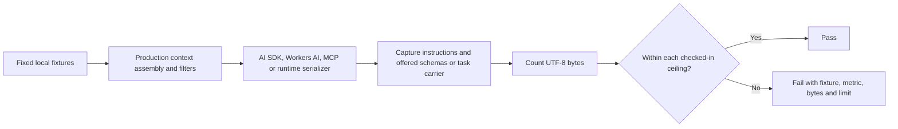

# Agent context size gate

Run `pnpm check:agent-context` after a frozen lockfile install with Node 24.
`pnpm check:ci` and GitHub's `biome-knip` validation job run the gate before
lint and Knip. The backend test suite also runs it. The test uses synthetic data, in-process model and daemon bindings,
and in-memory SQLite. It asserts that no network requests occur. It doesn't
start a Worker, sandbox, daemon, or real model.

## What the bytes mean

- **Coordinator:** the real Think first-inference builder runs with inert
  storage and a synthetic transcript. The AI SDK mock captures its normalized
  system messages and tool definitions after filtering and schema conversion.
  The separate Workers AI row measures the default provider's binding request
  shape, after the provider converts the descriptors. These are distinct
  boundaries, so do not add the rows together.
- **MCP:** the real Shiba handler and MCP SDK expose the built-in definitions
  through `tools/list`. Both supported protocol versions use a broad synthetic
  scope set and a narrow run-read scope; a revoked principal gets no
  definitions. MCP is a client discovery surface, not a model request.
- **Specialists:** Explorer and Reviewer send their native Workers AI
  instructions and structured output schema. The default provider adapter
  drops the Explorer's tool definitions on structured JSON requests, so neither
  captured request has tools. The gate records that fact without changing it.
- **Coding adapters:** the hosted Codex session job and paired OpenCode
  dispatch measure the actual assembled task and its task-bearing carrier.
  Hosted counts the complete job JSON file, including its trailing newline;
  paired counts the compact JSON projection of the envelope's `task` and
  `argv`, which includes a duplicated task. Neither measures the downstream
  CLI's provider request.

The check encodes each measured JSON projection with `JSON.stringify` and
counts it with `Buffer.byteLength`. It preserves string content, escaping and
array order. A tool-free projection is `[]` (2 bytes). Raw task strings and the
already-serialized job file aren't re-encoded as JSON. This is a regression
budget, not a tokenizer, context-window limit, latency benchmark, or claim
about inference cost.

Case IDs separate profile policies and grant states, cold and warmed Code Mode,
Chat opt-ins, and different serialization boundaries. The broadest sampled
dashboard Work case has a running computer and warmed Code Mode. The Slack
stress fixture uses 32 allowed facts of 500 Unicode code points with quotes and
markup; it is not a bound on every possible fact payload. Selected employee
fixtures exercise a real goal, the scoped directory and five reviewed skill
pins. Fixed synthetic content keeps their wrappers in the budget without
reading private data. User/assistant transcripts, tool results, IDs outside
the measured fields, uploaded data, external MCP/client catalogs, later-step
history, arbitrary configured providers, unrelated model utilities, and
provider/CLI-owned instructions are not budgeted. Add a named row or document a
reviewed exclusion when introducing another assembly path; don't treat this
matrix as an automatic inventory of model call sites.

## Intentional changes

Reproduce the same fixture on the target base and on the proposed change.
Inspect the per-row byte delta and first check whether a duplicate wrapper or
eager tool schema can be removed. If growth is necessary, change only the
affected ceiling in
[`agent-context-budgets.json`](../../apps/backend/test/fixtures/agent-context-budgets.json).
Record the two SHAs, old/new measurements and ceilings, why the growth is
needed, and why the remaining headroom is enough. Ask a reviewer other than
the author to approve it. Apply the same scrutiny to changing the
serializer/projection, shrinking a fixture, or removing a row; each can make
the gate easier to pass. The gate doesn't regenerate or waive budgets.

Initial ceilings leave roughly 4–12% headroom on normal nonempty rows, under
1% on the intentionally large Slack instruction fixture, and no headroom
when the expected tool set is empty. Independently review larger allowances
rather than copying the max from another row.

For negative proof, the test injects multibyte padding into an active tool
description and into system instructions, then asserts the same byte checker
rejects both. It also checks that padding an inactive tool or user message
doesn't change the measured projection.
