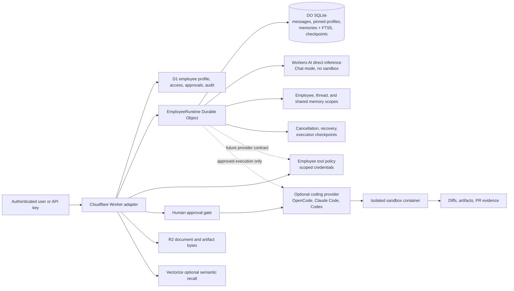

# Employee runtime migration

This document audits the current architecture and defines the migration to a
provider-independent AI employee runtime. It is an architecture plan, not a
claim that the target state exists.

## Audit

Shiba already has more employee infrastructure than the `CodingOrchestrator`
name suggests. The migration should move ownership and boundaries, not rebuild
every subsystem.

| Area | Current state | Migration problem |
|---|---|---|
| Employee identity | `org_custom_agents` and `org_custom_agent_versions` store versioned employee profiles in D1. `CustomAgentConfig` carries role, instructions, library links, tool scopes, approval policy, repository, harness, model, and sandbox preferences. | `harness` is now optional for new employees, but identity, model policy, tool authority, repository preference, and execution lane configuration still share one configuration blob. |
| Orchestration | `apps/backend/src/agents/orchestrator.ts` uses Cloudflare Agents SDK and AI SDK through `Think`. It owns approvals, run lineage, chat sessions, delegation, cancellation, and recovery. | The object is keyed by user/session/thread rather than by employee. Employee identity is metadata attached to a run or session, not the coordination boundary. The class name and large parts of its state model remain coding-run centric. |
| Chat and Work modes | Chat mode already exists. `conversation-mode.ts` disables tools for plain chat and allows selected read-only/generation tools for a single turn. App-only Work turns use the employee tool policy. | Both modes depend on the legacy orchestrator and its session naming. Work execution still centers on delegated coding runs and sandbox evidence contracts. |
| Coding providers | OpenCode, Claude Code, Codex, and other harnesses sit behind `harness/` transport shims. `OpenCodeAgent` is the sandbox-side execution child even when it drives another harness. | Provider selection is no longer mandatory in employee profile creation. Run admission still falls back to deployment coding-provider defaults when sandbox work is approved. |
| Sandbox execution | Sandbox containers provide isolated execution. Approval is minted before a sandbox starts, and egress attaches credentials outside the container. | This is the correct high-trust lane for terminal/code work. It is not optional enough: approval, evidence, and run concepts assume this lane in several contracts. |
| Memory | `Memory` Durable Objects store facts and owner memory. Vectorize stores embeddings. Memory routes and MCP tools exist. | Memory is split across agent-named facts, owner memory, conversation state, knowledge modules, and files. There is no single employee-private/thread/shared model with uniform tenant checks. |
| Workspace knowledge | D1, R2, files, notes, knowledge ingestion, projects, and semantic search already exist. | These capabilities are workspace features, not yet a repository-independent employee workspace with private files, generated artifacts, and shared knowledge under one permission model. |
| Tools and integrations | The lazy tool catalog, MCP registry, connected app actions, browser tools, media tools, and employee tool policy exist. `employee-run-tools.ts` resolves authority server-side. | Tooling is powerful but distributed. Approval requirements are not expressed as one execution-boundary contract across native tools, MCP, browser, terminal, external APIs, and employee delegation. |
| Scheduling and automation | `Automations`, queues, workflows, alarms, Slack/email ingress, routines, and run recovery exist. | Routines are not yet first-class employee schedules with per-employee spend, dedupe, delegation-depth, and notification policy. |
| Frontend | Custom employee profiles, roster/workspace surfaces, approvals, work views, files, memories, skills, and integrations exist in the dashboard. | Creation no longer forces a harness, but operation still exposes coding/repository concepts to non-technical users. There is no single employee-centric runtime surface for chat, work, memory, files, tools, schedules, and history. |
| Deployment state | Durable Objects coordinate live state. D1 owns shared records. R2 owns bytes. Vectorize owns embeddings. Queues and Workflows carry asynchronous control. | This ownership model is sound. The migration must not mirror all of D1 into the employee object. It needs a stricter split between durable domain state and live execution coordination. |

## Target ownership

Use one ownership rule for the target architecture:

- D1 owns shared, queryable domain records: employee profiles and versions,
  workspace membership, approvals, audits, files metadata, shared knowledge,
  tool grants, schedules, and execution history indexes.
- The `EmployeeRuntime` Durable Object owns live per-employee coordination:
  active conversations, checkpoints, cancellation, retries, working memory,
  in-flight execution state, and recovery leases.
- R2 owns object bytes for documents, generated artifacts, attachments, and
  private employee files.
- Vectorize may own optional semantic recall after tenant and employee
  permissions are enforced. FTS5 in SQLite owns exact search.
- Queues, alarms, and Workflows own asynchronous delivery and retry control.
  They never create authority by themselves.
- Sandbox harnesses are execution providers. They are not employee identity,
  memory, or chat infrastructure.

The solid path is the current trust boundary: the Worker authenticates and
scopes the actor, the employee object coordinates live state, and sandbox work
remains approval-gated. The dotted paths are the migration target: the runtime
chooses providers without transferring employee identity or memory ownership to
those providers.

## Migration phases

### Phase 0. Runtime foundation

Implemented in this branch:

- Add the `EmployeeRuntime` Durable Object binding and migration tag.
- Add shared wire contracts for employee runtime chat, memory, state, and
  cancellation.
- Store conversation messages, pinned profile envelopes, execution checkpoints,
  and employee-private working memory in the object's SQLite storage.
- Add FTS5 memory search with employee/thread separation. Memory create,
  update, and delete are server-mediated: employee-scope mutation requires
  manage authority, while thread memory mutation is bound to the caller's
  actor-scoped conversation.
- Add an authenticated `/api/custom-agents/:id/runtime/*` adapter. The Worker
  loads the employee profile from D1 and forwards a server-owned frozen
  envelope. The caller cannot invent identity, instructions, version, harness,
  repository, or model authority.
- Add direct chat inference through Workers AI and the AI SDK for controlled
  deployment owners. Team-workspace inference fails closed until the exact
  funded team-model turn contract is integrated; verification standin remains
  inference-free.
- Namespace conversations by the authenticated actor at the Worker boundary so
  shared employees do not expose private threads. Cancellation is bound to the
  scoped conversation and recovery requires manage authority.
- Add cancellation plus checkpointed interrupted-execution recovery. Manager-initiated, optionally thread-scoped recovery replays the exact pinned user message when no assistant response was persisted, completes already-persisted executions without duplicating them, and fails closed for unfunded team inference.
- Add SSE streaming for runtime chat and a details-panel runtime chat surface
  that streams answers, stops generation, and lets authorized managers recover
  interrupted work for the selected thread without creating a sandbox. Runtime
  state explicitly marks interrupted or abandoned running executions as
  recoverable so restarts do not hide the recovery action.

This slice proves the boundary only. It does not complete resumable streaming,
tools, scheduling, workspace files, provider switching, funded team inference,
or the full employee memory migration.

### Phase 1. Decouple employee identity from coding providers

Implemented in this branch: `harness` is optional in saved employee profiles, onboarding no longer injects OpenCode, and the composer omits harness authority when an employee has no explicit coding provider.

Remaining:

- Make `codingModel`, `defaultRepoUrl`, and `sandboxProvider` clearly grouped
  optional execution-provider preferences rather than peer identity fields.
- Add provider-independent model configuration for direct inference.
- Keep existing saved profiles valid by treating their harness fields as a
  migration-backfilled `coding` provider preference.
- Update employee creation so non-technical users can create a conversational
  employee without selecting a repository, sandbox, or coding harness.
- Add migration tests for old profiles, archived profiles, version pinning,
  and cross-org isolation.

### Phase 2. Move chat onto the employee runtime

- Move the main employee conversation surface from the legacy orchestrator to
  the runtime. Implemented first lane: thread-backed personal conversations
  for employees render the runtime SSE surface in the main chat panel when the
  thread has no legacy orchestrator messages. Existing legacy threads stay on
  the compatibility lane so profile edits do not hide their history; Work mode,
  teams, and default threads remain on the compatibility orchestrator until
  their migration lanes are verified.
- Make streams resumable after disconnects through the Agents SDK chat patterns
  or an equivalent checkpointed transport.
- Share employee identity, memory, and conversation context across Chat and
  Work modes.
- Add cancellation of live streams, checkpoint replay after eviction, retry
  budgets, and interruption recovery tests.
- Keep the legacy orchestrator as the compatibility lane until dashboard and
  channel callers migrate. Remove it only after callers move.

### Phase 3. Make execution providers pluggable

- Define one execution-provider contract: prepare, approve, execute, stream,
  cancel, checkpoint, recover, and emit evidence.
- Implement direct inference as the default provider.
- Implement app/tool execution as a provider using existing employee tool
  policy.
- Implement sandbox coding as a provider around the existing approval and
  `OpenCodeAgent` lane. Preserve approval-before-sandbox and credential
  isolation exactly.
- Add provider-switching tests that prove identity, memory, and execution
  history survive a switch.

### Phase 4. Consolidate memory and knowledge

- Separate employee-private, thread-specific, and shared company knowledge in
  the schema and retrieval APIs.
- Migrate existing Memory DO facts and owner memory before changing Vectorize
  behavior.
- Add memory CRUD, review, consolidation, summaries, reusable skills, and
  essential-memory context selection.
- Enforce tenant, workspace, employee, and thread permissions inside retrieval,
  not only in route handlers.
- Keep Vectorize optional and degrade to FTS5 when it is absent.

### Phase 5. Build repository-independent workspaces

- Use R2 for bytes and D1 for metadata.
- Support folders, notes, documents, generated artifacts, private employee
  files, and shared company knowledge.
- Treat repositories as linked resources only when a task needs one.
- Add permission and lifecycle tests for private files, shared files, generated
  artifacts, and deleted employees.

### Phase 6. Unify tools and approvals

- Build one tool registry across native tools, MCP servers, browser automation,
  terminal execution, external APIs, connected apps, and employee delegation.
- Attach per-employee permissions, credential scopes, audit records, and
  approval requirements to the registry entry.
- Enforce approval at the execution boundary after model selection, never as a
  prompt instruction.
- Add audit tests for denied tools, unapproved side effects, expired approval,
  cross-tenant credentials, and recursive delegation.

### Phase 7. Add employee scheduling and collaboration

- Represent routines as employee-owned schedules in D1.
- Use Durable Object alarms for due work and Queues/Workflows for retryable
  execution.
- Add dedupe keys, delegation-depth limits, spend budgets, and notification
  policy.
- Test duplicate event delivery, recursive delegation, interrupted execution,
  and schedule recovery.

### Phase 8. Finish the employee-centric frontend

- Put profile, chat, work, activity, memory, skills, tools, files, schedules,
  approvals, and history under one employee surface.
- Make custom employee creation prompt-driven and hide coding-provider choices
  unless the user asks for repository execution.
- Add dashboard integration tests for creation, chat, memory, provider choice,
  approvals, interruption recovery, and employee isolation.

## Verification rule

A phase is complete only when its migration is deployed behind a compatible
contract and its tests verify real behavior. Typecheck alone does not count.
For execution work, verification must prove that no sandbox starts before the
required approval and that credentials never enter a container.
