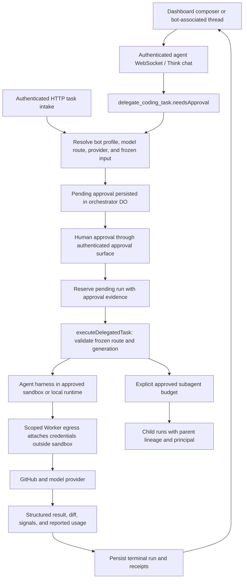

# Bot, thread, and orchestration audit

Audited on 2026-10-28 against Shiba's checked-out code and Overlay commit `49146167572130e171db8d566edc0bf2f176aa73`. This report distinguishes executable local tests from external-provider proof. Overlay was inspected as a reference; its services and paid providers were not executed here.

## Actual execution path



The local integration suites exercise the approval, run, review, cancellation, and result paths using a fake harness and mock GitHub. They do not prove successful live inference, real GitHub publishing, container provider connectivity, or deployment.

## Findings and implemented changes

| Priority | Before | Root cause | Result and executable evidence |
| --- | --- | --- | --- |
| P0 | A custom bot with stored `approvalPolicy: auto_approve` could cause HTTP task intake to call approval resolution itself. | `queueSlackRun` treated reusable profile configuration as approval of a new frozen task. | Intake now always leaves a pending human approval. Legacy profiles remain readable. `custom-agent-approval-gate.test.ts` verifies no resolver call, no run reservation, and no harness execution. |
| P1 | A deleted chat bot silently fell back to a generic agent; absent D1 similarly skipped selected-profile resolution. | Conditional registry reads and clearing `customAgentId` on a missing profile. | HTTP returns 503 for absent storage; chat throws an actionable error; deleted profile does not mint a fallback approval. Regression cases cover both paths. |
| P1 | Custom bot sandbox selection could be checked against the deployment default; chat could show an approval before checking the selected sandbox provider. | The private route preflight received model fields without the already-resolved sandbox provider. | Route preflight now receives the selected provider. Tests verify a Cloudflare profile overrides an incompatible E2B deployment default, and an unsupported selected provider is rejected before a chat approval. |
| P1 | Cancelling a root left grandchildren running; slow cleanup also delayed fencing children. | Only direct children were cancelled, and cancellation awaited provider cleanup before traversing descendants. | All active descendants are now fenced and aborted synchronously before cleanup; traversal includes terminal intermediate records, is cycle-bounded, and releases each shared sandbox once. Tests cover deep lineage, reviewers, unrelated runs, shared sandboxes, and held cleanup. |
| P1 | Subagent routes could use another agent principal's parent, spawn from terminal parents, or enter deleted sessions. Malformed path encoding could throw. | Missing ownership/lifecycle checks on the subagent-specific path. | Both spawn aliases verify the vouched principal; terminal parents return 409; deleted sessions return 410; malformed IDs return 400; children inherit their parent's `queuedBy`. Tests cover foreign ownership, all terminal statuses, budget preservation, valid owner spawn, and malformed IDs. |
| P1 | Public subagent APIs always returned empty trees or placeholder 404s after internal subagent persistence had shipped. | `/api/v1` still contained its earlier Phase 2b placeholder. | Thread lists now return persisted descendants with pagination; detail reads resolve visible lineage; message reads expose only stored task/final summary. Independent tree paths, hidden ancestors, cycles, errors, and scopes are tested. OpenAPI and generated SDK types were aligned. |
| P1 | Overlapping task retries using one command ID could mint different approval records. | The receipt was checked only before asynchronous profile/model/provider validation, so both requests could pass the initial check. | Intake now checks the receipt again at the synchronous mint boundary. A deterministic regression holds two requests in model preflight and verifies one approval and one receipt after release. |
| P1 | Bot execution lost its selected profile identity/version/provider when the pending approval became a run. | The run constructor and pure queue decider omitted the caller's custom-agent/provider/org fields, and computed profile versions were discarded. | Trusted profile version is now frozen into the approval hash, run record, and execution envelope; selected profile/provider/org persist through results. HTTP and chat regression flows queue v1, edit the profile to v2 before approval, and prove the mocked harness and terminal run still use v1 instructions/model/version. |
| P1 | A queued bot approval could start after its profile was archived/deleted; legacy tool scope settings were stored without enforcement. | Approval resolution did not recheck profile availability and runtime ignored configured scopes. | Approval checks availability without substituting the current profile's instructions or route; unavailable profiles return 409 without reserving a run. Nonempty unsupported legacy scopes fail explicitly on HTTP/chat intake and approval. |

Implementation files:

- `apps/backend/src/agents/orchestrator.ts`
- `apps/backend/src/den/spawn.ts`
- `apps/backend/src/v1/subagents.ts`
- `apps/backend/src/v1/openapi.json`
- `packages/sdk/src/generated/openapi.ts` (intentionally regenerated)

Regression suites:

- `apps/backend/test/orchestrator.test.ts`
- `apps/backend/test/custom-agent-approval-gate.test.ts`
- `apps/backend/test/v1-subagents.test.ts`

## Relevant Overlay comparison

| Capability | Overlay evidence | Shiba evidence and status | Remaining work |
| --- | --- | --- | --- |
| Bot and agent identity | `convex/agents/connectedAgents.ts`, `convex/agents/agentThreads.ts`, `src/shared/agents/agent-lineage.ts` contain explicit agent/thread identity and lineage. External runtimes are launch-gated in `FEATURES.md`. | PARTIAL: D1 custom profiles and named web sessions exist; custom profile instructions/model/provider are frozen before execution. Selected-profile errors and mandatory approval are now locally tested. | Complete browser and provider-backed bot-to-thread journeys; keep thread identity distinct from run identity when adding multi-run APIs. |
| Runtime lifecycle | `convex/agents/remoteRunModel.ts` and `remoteRuns.ts` record explicit attempts, cancellation, reconciliation, and recovery facts. | PARTIAL: generation fences, terminal outcomes, pre-sandbox restart resumes, outcome-unknown after possible side effects, container leak tracking, and hierarchical cancellation have local tests. | Validate restart/reconciliation against actual deployed providers. Preserve unknown outcomes instead of replaying possibly completed external mutations. |
| Subagent observability | Reference agent lineage helpers and connected-agent run state exist; code presence does not prove enabled external execution. | WORKING for the locally tested persisted read projection: internal subagent records now appear through public tree/detail APIs. Live spawning against real providers is NOT VERIFIED. | Persist full harness transcripts only if needed; the current API explicitly exposes task/summary, not invented live message history. |
| Approval and permissions | Overlay has native approval and attempt-scoped policy/recovery code; launch availability depends on feature gates. | WORKING for tested local approval semantics: a profile never approves its own new task; explicitly approved subagent budgets remain the delegation mechanism. | Run deployed provider acceptance checks without weakening the human approval, scoped GitHub, or external credential invariants. |

Adopt explicit lineage, visible lifecycle facts, attempt/generation fencing, and truthful unavailable states. Do not import Overlay's Convex, managed computer, billing, or external-runtime assumptions merely to match its feature vocabulary. Shiba's Worker/DO architecture and approval boundaries are already established contracts.

## Validation evidence

Focused final command:

```sh
source /workspace/.tools/shiba-env.sh
pnpm -C apps/backend test \
  test/custom-agent-approval-gate.test.ts \
  test/chat-gate-pin.test.ts \
  test/orchestrator.test.ts \
  test/v1-subagents.test.ts \
  test/v1-phase6.test.ts \
  test/custom-agents-resolve.test.ts \
  test/orchestrator-fencing.test.ts \
  test/phase1-core-loop.integration.test.ts \
  test/sandbox-release-policy.test.ts
```

Result: **142 tests passed in 9 files**, none failed or skipped in this selected run. A later idempotency regression was verified with `custom-agent-approval-gate.test.ts` and `orchestrator.test.ts` together: **88 tests passed in 2 files**. Before the initial lifecycle fixes, 10 targeted regression cases failed. Lint on the touched orchestration files exited successfully with existing-style warnings; no automatic fixes were applied.

Backend source and test TypeScript checks passed (`tsc -b` and `tsc --noEmit -p tsconfig.test.json`). Generated SDK synchronization and both SDK TypeScript configurations passed; the SDK's 6 tests passed in 2 files. `git diff --check` was clean. Mocked integration proof is distinct from browser proof and live-provider proof.

Subsequent bot provenance work passed **157 tests in 5 files** (`custom-agent-approval-gate`, `decide`, `orchestrator`, `phase1-core-loop.integration`, `tradeoff-contracts`), followed by **14 tests in 3 wire/preflight suites**. Backend source and test TypeScript checks passed again. These tests use the real approval/run/dispatch code with a mocked harness; they do not establish live model inference.

## Remaining limits and priorities

- P1: Prove the deployed submit → human approve → actual provider execution → honest diff path, including cancellation and restart. This requires configured provider/account access; local tests cannot establish it.
- P1: Expand persisted thread APIs independently of the current run-as-thread adapter. Thread rename, unarchive, compaction, and optimistic metadata versions currently return explicit 501 responses in `v1/threads.ts`.
- P1: Exercise all harness lanes against actual CLI/provider output. Existing parser fixtures do not establish live compatibility for every lane.
- P2: Decide whether full harness message retention is a product requirement. The implemented subagent message projection contains only the stored task and final summary; unavailable token/cost usage is null, not fabricated zero credits.
- P2: Add provider-backed crash and cancellation acceptance checks to complement generation-fencing tests.

Production readiness is **PARTIAL**. Local behavioral tests support the scoped fixes; they do not make a live end-to-end or deployment claim.
