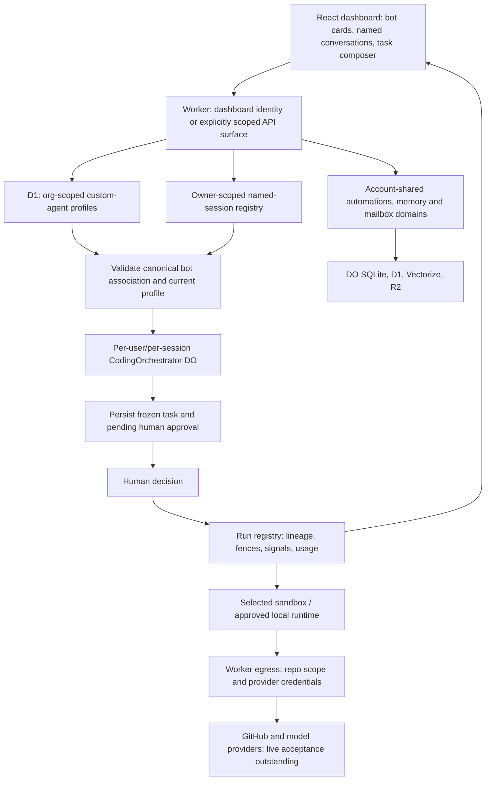

# Shiba bot/thread implementation and Overlay audit

Latest verification: [final recheck](final-recheck.md), **3,166 tests passed,
3 skipped**, with browser/Electron and same-state local-daemon acceptance.
That report supersedes the earlier counts and evidence pointers below.

Audit date: 2026-10-28. Working branch: `codex/overlay-parity-audit`.
Shiba base commit: `0e58b4698c34d5190e97af938fc51e6179054cdf`.
Overlay reference commit: `49146167572130e171db8d566edc0bf2f176aa73`.

Shiba's local development workflow is prepared, and relevant bot/thread behavior
and reproduced reliability/security defects have been improved. **Full Overlay
parity and production readiness are not established.** The real local browser
journey verifies UI/API/storage behavior; the coding/review journey uses mock
GitHub and synthetic execution. Neither proves live model inference.

Ten worker agents contributed inspection, implementation, regression tests, and
independent reviews, with at most six workers running alongside the coordinator.
Changes remain on the separate branch for review. No deployment, merge,
production payment, live external message, or real GitHub publication occurred.

## Comparison and scope

The [19-category feature matrix](overlay-reference.md#feature-parity-matrix)
contains the requested Feature / Overlay status / Shiba status / Evidence /
Missing functionality / Priority columns. Its detailed
[bot/thread comparison](overlay-reference.md#bot-and-thread-comparison) separates
agent definitions, conversations, and executions. It records the baseline;
the changes and executable results below supersede baseline defects fixed here.

Shiba is an approval-gated software-engineering coworker. Overlay is a broader
human/agent workspace. Shiba's named web sessions are persistent conversations;
its public v1 compatibility API often projects individual runs as threads. These
are different contracts. New bot-linked conversations reuse the existing
owner-scoped session registry rather than introducing another database or vendor.

Overlay itself disables several external-agent/control-plane features by
default. Its feature inventory is not proof of live operation. Only eight small
reference helper tests were executed; reference app E2E, full build, and provider
services were not prepared or certified.

## Current architecture

Org-scoped profile CRUD does not make all runtime domains tenant isolated.
Bearer access to shared v1 runtime stores returns an explicit unavailable
response until consistent org/principal routing exists.

## Implemented changes and root causes

| Area | Reproduced problem / root cause | Final implementation and files |
| --- | --- | --- |
| Bot conversations | Custom-agent CRUD and named sessions lacked a direct association/navigation flow. | Start a fresh associated conversation, list each bot's conversations, reopen them, and restore profile defaults. `apps/frontend/src/agent-threads.ts`, `app.tsx`, `components/CustomAgentsView.tsx`. |
| Rename and refresh | No named-thread rename UI; stale replies and the base-agent-only history guard could lose names or skip named-session history. | Server-confirmed rename with failure/retry handling, timestamp guard, correct named-agent history fetch, stale-response checks, and scoped profile restoration. `components/ThreadTitleEditor.tsx`, `agent-threads.ts`, `agent-thread-defaults.test.tsx`. |
| Association integrity | Arbitrary metadata could claim a missing, foreign, deleted, or unsupported bot. | POST/PATCH validate exact canonical bot ID in the dashboard org before persistence; missing/outage storage fails explicitly. Name-only changes and historical reading remain available. `apps/backend/src/sessions-routes.ts`, `test/session-agent-association.test.ts`. |
| Saved skills | Bookmark labels/URLs were forwarded while saved instruction notes were omitted, including from the pinned task input. | Include saved notes in actual local/cloud task inputs and model context. `apps/frontend/src/skill-prompt.ts`, `app.tsx`. |
| Human approval | A legacy profile's `auto_approve` setting could resolve a newly queued task without reviewing its frozen input. | Preserve legacy configuration records while requiring human approval for the new task. Missing/deleted profiles fail instead of falling back. `apps/backend/src/agents/orchestrator.ts`, `test/custom-agent-approval-gate.test.ts`. |
| Provider choice | Preflight could check the deployment default instead of the selected bot's sandbox provider. | Pass the resolved provider into route preflight before minting an approval. `agents/orchestrator.ts`. |
| Cancellation | Only direct dependents were cancelled, and provider cleanup delayed fencing descendants. | Fence and abort all active descendants before awaiting cleanup; traverse terminal intermediates and release shared sandboxes once. `agents/orchestrator.ts`, `test/orchestrator.test.ts`. |
| Subagents | Missing ownership/lifecycle checks and placeholder public read APIs. | Verify parent principal/state/session, inherit ownership, reject malformed IDs, and project persisted trees/detail/task-summary messages with pagination. `src/den/spawn.ts`, `src/v1/subagents.ts`, `test/v1-subagents.test.ts`. OpenAPI and SDK types intentionally regenerated. |
| API authentication | Outer gate blocked org-authenticated handlers; ambient identity could override a limited bearer; grouped v1 handlers ran before scope checks. | Narrow self-authenticated route exemptions, explicit-credential precedence, central read/write checks, and fail-closed bearer runtime routing. `index.ts`, `public-routes.ts`, `org-request-auth.ts`, `api-keys-routes.ts`, `v1-auth.ts`, `v1-routes.ts`, `v1/system.ts`. |
| Agent URL parsing | Extra path segments reached CRUD; malformed percent encoding threw. | Exact collection/one-ID route shape and explicit 400/404 responses, including the v1 alias. `custom-agents-routes.ts`, `test/custom-agent-paths.test.ts`. |
| Scheduler accounting | A tick saved its pre-webhook snapshot over new usage counters, permitting a same-tick daily-budget bypass. | Reload persisted counters after webhook processing before evaluating schedules. `automations-do.ts`, `test/automations-tick.test.ts`. |
| Webhook delivery | Accepted batches were deleted before queue success; overlapping ticks, ambiguous responses, configuration changes and unattended-resolution failures could lose work or miscount it. | Durable attempt lease, frozen queue intent, persisted approval/charge, bounded retry/backpressure, and authority checks against the frozen intent. `automations-do.ts`, `test/webhook-batch-reliability.test.ts`. Dedupe depends on 256 retained command receipts; this is not an unlimited exactly-once guarantee. |
| Concurrent queue retries | A command receipt was checked before awaited preflight, allowing simultaneous retries to both mint approvals. | Recheck the receipt immediately before synchronous approval/receipt persistence; a held-preflight regression proves one approval. `agents/orchestrator.ts`, `test/custom-agent-approval-gate.test.ts`. |
| Local startup | Child process environment overrides erased PATH; migration failures were ignored; container-disabled startup attempted a remote proxy. | Merge inherited environment, preserve startup failure status, and use explicit local Wrangler mode. `scripts/local-dev.mjs`, `scripts/shiba-dev-lib.mjs`, `test/deploy-scripts.test.ts`. |
| Browser regression gate | Browser downloads were unavailable and new bot/thread coverage was manual-only. | Optional system Chromium path, reusable local bot/thread driver, CI opt-in before cleanup, failure-evidence preservation, and uploaded bot/thread artifacts. `.cursor/skills/verify-shiba/`, `.github/workflows/ci.yml`, `test/verify-ci-evidence.test.ts`. |

Further orchestration detail and before/after regressions are in
[orchestration.md](orchestration.md). Integration/storage boundaries are in
[integrations-audit.md](integrations-audit.md).

The subsequent [agent lifecycle implementation](agent-lifecycle-parity.md#implemented-lifecycle-and-executed-acceptance)
adds model/connection form controls, conflict-safe atomic profile edits and
history, reversible agent archive/restore, and frozen profile-revision
provenance through execution. It fixes run creation dropping selected agent,
provider and org fields. Its connected browser journey covers configuration,
thread, frozen approval, an actual Approve click, synthetic execution, retained
result, archive, restore and historical access. Conversation archive/restore is
still a distinct gap.

## End-to-end flow evidence

| Flow | Result | Actual exercised path and limitation |
| --- | --- | --- |
| Bot create → thread → rename → refresh | PASS for local UI/API/storage | Browser form → Worker identity → D1 profile → named-session DO registry → PATCH → refreshed UI. Rename failure is injected as HTTP 503; successful retry uses the real local API. |
| Bot/thread isolation and defaults | PASS for scoped local checks | Browser default/named switching plus frontend helpers and backend negative association tests. Full unrelated-tenant runtime isolation remains outstanding. |
| Named chat history retrieval | PASS for regression contract | Correct named-agent URL and stale-switch denial are tested. Empty-thread browser checks do not prove persisted real-model transcripts. |
| Task → approve → execution → PR → review | PARTIAL | Existing browser journey shows approval, approves via API, then checks synthetic execution and mock GitHub read-backs plus rendered findings. No real harness/model/GitHub mutation. |
| Reject/cancel/ownership/races | PASS for tested local contracts | Existing core-loop/fencing/egress tests plus descendant, terminal-parent, foreign-principal and deletion regressions use controlled harnesses and storage. Cloud eviction/cancellation remains unverified. |
| OAuth, RAG, integrations, real containers | NOT VERIFIED | Local listeners and code/tests exist; no provider consent, real inference, embeddings/Vectorize, real messages, or sandbox-image execution was certified. |
| Worker package | PASS for bundle-only dry run | Wrangler `--dry-run --containers-rollout none` packages the Worker/assets. The container image was not built or deployed. |

## Final validation record

All results below are from this cloud instance and changed branch on
2026-10-28. Full tests ran after releasing development OAuth ports, with two
Vitest workers and one workspace task at a time. Earlier intermediate failures
were diagnosed: a dev listener occupied the desktop callback port, heavy
concurrent compilation exceeded test import deadlines, one old source-text
assertion no longer matched the extracted history loader, and an unfinished
concurrency fixture awaited an intercepted import. The port/resource conflict
was removed, the history assertion now exercises behavior, and the concurrency
test uses the real held-preflight seam. No assertions or suites were disabled.

| Check | Actual final result |
| --- | --- |
| `pnpm test --concurrency=1 -- --maxWorkers=2` | PASS after the Bot launch and named-session panel fixes: **3,148 tests passed, 3 skipped**; 269 test files passed and one live-provider file skipped; all 8 workspace test tasks completed. Backend 2,714; frontend 180; desktop 192; auth 11; sandbox 34; SDK 6; ACP 8; login 3. |
| `pnpm typecheck` | PASS: all 10 workspace tasks, root TypeScript build, and SDK generated-type synchronization. |
| Workspace build + asset assembly + docs verification | PASS: all 6 build tasks; 62 HTML pages, 3,722 local links/assets/anchors, Pagefind output and 43 markdown claim checks. Astro diagnostics are clean. |
| `pnpm check:ci` | PASS with lint warnings and reported existing Knip findings under the repository's configured threshold; not a zero-warning claim. |
| `pnpm lint:imports --concurrency=2` | PASS: 6 workspace lint tasks. |
| `pnpm test:built` | PASS: built marketing-output assertion executed, 1 test passed. |
| `pnpm check:deploy` / `pnpm check:dev-vars` | PASS: stack/binding drift and local-variable documentation checks. |
| Combined `verify-shiba` CI driver with `VERIFY_AGENT_THREADS=1 VERIFY_AGENT_LIFECYCLE=1` | PASS: **11 mock core-loop + 9 local bot/thread + 11 Bot lifecycle checks**. The affected lifecycle was refreshed again after the session-routing fix. Creation, launch, composer queueing, retry and approval use the visible UI; execution remains synthetic. Fixtures cleaned by exact returned IDs. |
| Actual Electron application | PASS: **5 shell/harness E2E tests + 11 real-dashboard lifecycle checks**, with renderer sandbox and native bridge assertions. The final 11 include scoped review/PR panel checks. Linux execution; native macOS and live inference remain unverified. See [desktop evidence](desktop-web-e2e.md). |
| Real Worker and local daemon | PASS in web and Electron: **9 UI steps + 12 protocol checks each**, including bot creation/launch, composer queueing, human task/tool approval, native Git/file edits, scoped diff display, and cancellation of run-owned CLI/tool processes. Model CLI is a deterministic fixture. See [local-runtime evidence](local-runtime.md). |
| Saved install script executed again | PASS: frozen install, SDK temporary generation/compare, all applicable builds, docs checks, idempotent migration; manifests, lockfile, workspace declaration and generated SDK source retained their pre-install hashes. |
| Service restart after unit tests | PASS: Worker setup JSON, Vite JSON proxy, Worker HTML shell and emitted JS asset each returned HTTP 200. OAuth listeners started; development services retained running. |
| Worker dry run with `--containers-rollout none` | PASS: Worker/assets bundled; no upload, image build or deployment. |
| `git diff --check` | PASS. Dependency manifests and lockfile are unchanged. |

The three skipped tests belong to the credential-dependent TypeSafe live suite.
They were not counted as passing. No live inference, production OAuth, external
messaging, deployed cron, actual container run, hosted CI execution, or fresh-task
snapshot restoration is claimed.

Retained local evidence includes `/tmp/shiba-test-final.log`,
`/tmp/shiba-typecheck-final.log`, `/tmp/shiba-build-final.log`,
`/tmp/shiba-check-ci-final.log`, `/tmp/shiba-setup-final.log`,
`/tmp/shiba-browser-final.log`, `.verify/drive/assertions.json`,
`.verify/agent-threads/result.json`, trace/screenshots, and
`.verify/evidence/ci-local-20261028T050306Z/`. Artifacts under `.verify` are
ignored development outputs; audit reports and reusable test drivers are saved
with the branch changes.

The desktop follow-up's full validation logs are
`/tmp/shiba-desktop-full-tests.log`, `/tmp/shiba-desktop-typecheck-all.log`,
`/tmp/shiba-desktop-build-all.log`, `/tmp/shiba-desktop-check-ci.log`,
`/tmp/shiba-desktop-imports.log`, `/tmp/shiba-desktop-install-repeat.log`, and
`/tmp/shiba-desktop-e2e-final-current.log`. The latter reran and passed all five
Electron tests after the local-daemon process-group fixes.

The final Bot follow-up supersedes those counts: logs are
`/tmp/shiba-bots-final-{tests,typecheck,build,check-ci,imports,built-test,deploy-check}.log`.
Lifecycle evidence was refreshed in `.verify/{agent-lifecycle,desktop-agent-lifecycle}/`;
actual local-daemon evidence is in `.verify/local-daemon-e2e/ui-{web,desktop}/`.
The [Bot launch guide](bots-e2e.md) describes the actual workflow and proof limits.

## Reusable environment

The prepared instance uses Node 24.19.0 and repository-pinned pnpm 10.34.4.
Frozen-lockfile dependencies, compiled app/docs/tool outputs, local D1 migration,
and repository-supported local configuration are installed. Writable cache and
configuration paths live below `/workspace`; no TLS/signature/checksum checks
were disabled. Existing Git proxy authentication was verified read-only.

The environment draft saves complete `install_script` and `start_skill` fields.
Installation verifies generated SDK types via a temporary output rather than
rewriting tracked source, and checks protected files against their pre-install
hashes so existing work is preserved. Startup initializes pinned tools, reuses
the existing isolated checkout, starts local Worker/Vite/OAuth services, and
requires functional JSON/HTML/proxy responses. Docs startup is optional.

Draft persistence does not execute, apply, or publish a new environment version.
Review and save the environment settings, then publish through the product when
desired. Fresh-task snapshot restoration has not been independently tested.
Live processes must be restarted in future tasks.

## Remaining work and production assessment

The [production acceptance checklist](production-readiness.md) gives P0/P1/P2
criteria and configuration prerequisites. Highest priorities are consistent
tenant storage/visibility policy before opening shared runtime APIs; real
provider/OAuth/container acceptance; crash/cancel/restart evidence; and
operational backup, rollback, monitoring, and cost controls.

Conversation parity still lacks formal archive/restore semantics, a canonical
multi-run public conversation/transcript API, optimistic metadata versions,
questions/compaction, and complete accessibility acceptance. General document
ingestion, cross-device skills, arbitrary upstream MCP servers, hard model-spend
enforcement, and SaaS billing are separate product decisions. Unknown usage must
not be represented as proven zero spend.

Do not copy Overlay's vendors, broad tool presets, dormant external runtimes,
payments stack, branding, or document-workspace scope merely to match a feature
inventory. Preserve Shiba's approval, credential, repository-scope, and existing
Worker/DO/D1 architecture contracts.

The environment supports the selected local development workflow. The product
remains a prototype pending the explicit live and operational acceptance above.

The selected laptop target is macOS. The desktop workflow now includes the
actual-dashboard lifecycle and unsigned packaging on a macOS runner, and gates
tag release jobs on those checks. That workflow has not been pushed or executed
here, so neither a Mac installer nor signing/notarization is certified. The
development instance has no ready model connection. The later Reason Machines
reference was blocked by the environment proxy with CONNECT 403; requested
domains were saved to the environment draft, but not applied/published. No
Reason Machines feature or visual parity is claimed without reference access.
