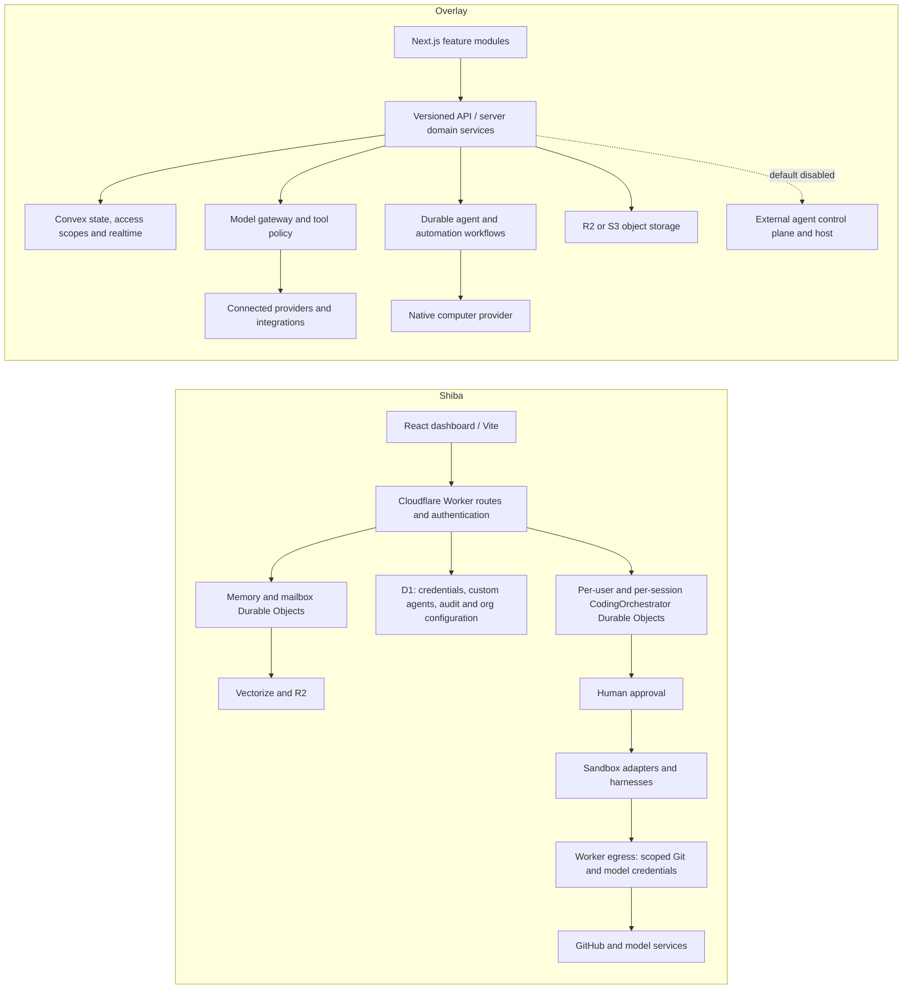

# Overlay reference audit

Audit date: 2026-10-28. Reference: [`LayerNorm/overlay-web`](https://github.com/LayerNorm/overlay-web/tree/49146167572130e171db8d566edc0bf2f176aa73), commit `49146167572130e171db8d566edc0bf2f176aa73`. Shiba was inspected on branch `codex/overlay-parity-audit`. This document records the reference inspection and the initial Shiba comparison; the implementation/validation report records subsequent fixes and test results.

## Evidence limits

The reference checkout was inspected without installing its application dependencies, starting its services, or connecting production accounts. No reference application flow is certified WORKING. Overlay's own `FEATURES.md` explicitly says its status describes checked-in defaults, **not a production audit**. A route, test file, enabled flag, or README claim is source evidence only.

Status meanings: **WORKING** requires executed evidence for the stated scope; **PARTIAL** means an implemented subset with identified gaps; **BROKEN** requires a reproduced failure; **MISSING** means no implementation was found in the inspected surface; **NOT APPLICABLE** means outside the selected product scope; **NOT VERIFIED** means runtime evidence is absent. A PARTIAL classification does not certify the implemented subset end to end.

Shiba is primarily an account-owned, approval-gated coding coworker. Overlay is a broader human/agent workspace with conversation, content, knowledge, collaboration, billing, and native tool-execution domains. Equal feature names do not imply equal semantics.

## Architecture traced in code



Shiba evidence: `apps/frontend/src/components/TaskComposer.tsx`, `apps/backend/src/index.ts`, `apps/backend/src/agents/orchestrator.ts`, `apps/backend/src/egress.ts`, `apps/backend/src/custom-agents-store.ts`, `apps/backend/src/memory-do.ts`, `apps/backend/wrangler.jsonc`.

Overlay evidence: `docs/developer/contribute/architecture.mdx`, `src/server/agents/WorkspaceAgentService.ts`, `src/server/conversations/AgentRunService.ts`, `src/server/workflows/workspace-agent-turn.ts`, `convex/schema.ts`, `src/shared/config/defaultOverlayRuntimeConfig.ts`. The architecture documentation is checked against these implementations rather than treated as execution evidence.

## Feature parity matrix

Overlay paths below refer to the pinned reference checkout. Shiba paths refer to this repository. Priorities describe relevant Shiba development, not a promise to reproduce every reference feature.

| Feature | Overlay status | Shiba status | Evidence | Missing functionality / qualification | Priority |
| --- | --- | --- | --- | --- | --- |
| Authentication, sessions, OAuth, authorization | NOT VERIFIED | PARTIAL | Overlay: `src/server/auth/providers/{workos,better-auth,oidc}-auth-provider.ts`, `convex/lib/auth.ts`. Shiba: `apps/backend/src/{request-auth,access-jwt,better-auth}.ts`, `packages/auth/src/controller.ts`, `apps/backend/src/provider-oauth/`. | Shiba has real implementations and auth tests; provider sign-in, refresh, cookie behavior and external account linking still need configured-browser acceptance. An unset production auth gate must never become public loopback fallback. | P0 |
| Onboarding and workspace management | NOT VERIFIED | PARTIAL | Overlay: `src/server/workspaces/WorkspaceService.ts`, `convex/collaboration/`, `src/contexts/WorkspaceContext.tsx`. Shiba: `apps/frontend/src/components/{FirstRunWizard,OnboardingModal}.tsx`, `apps/backend/src/setup-{status,doctor}.ts`, `apps/backend/src/org-request-auth.ts`. | Shiba setup is account/integration oriented; it is not a complete team workspace, invitations, memberships and resource-sharing product. | P1 |
| Chat, model routing, streaming, tool calling | NOT VERIFIED | PARTIAL | Overlay: `src/server/conversations/{ActContextService,ActMessagePersistenceService,AgentRunService}.ts`, `src/server/ai/gateway/gateway-runtime.ts`, `convex/chat/`. Shiba: `apps/backend/src/agents/orchestrator.ts`, `apps/backend/src/model-policy.ts`, `apps/backend/src/v1/{messages,stream,events}.ts`. | Verify real model output, tool results, reconnect, reload and cancellation independently. Shiba v1 capabilities explicitly report `fullTranscripts: false`; a run event projection is not a full canonical conversation transcript. | P1 |
| Agent creation, configuration, execution, lifecycle | PARTIAL | PARTIAL | Overlay: `src/server/agents/WorkspaceAgentService.ts`, `src/features/agents/components/NewAgentDialog.tsx`, `convex/agents/profiles.ts`. Shiba: `apps/backend/src/custom-agents-{routes,store,schema,resolve}.ts`, `apps/frontend/src/components/CustomAgentsView.tsx`. | Both contain configurable-agent code. Overlay's native agents are enabled; external runtimes are intentionally disabled by default. Shiba custom-agent CRUD must be distinguished from proving an approved execution uses the saved configuration. | P1 |
| Agent orchestration and delegation | PARTIAL | PARTIAL | Overlay: `src/server/workflows/workspace-agent-turn.ts`, `src/server/agents/agent-mcp-tools.ts`, `src/server/agents/external-agent-policy.ts`. Shiba: `apps/backend/src/orchestration/`, `apps/backend/src/agents/orchestrator.ts`, `apps/frontend/src/components/SubagentTree.tsx`. | Native and external delegation have different release gates in Overlay. Preserve Shiba's immutable approved task, bounded fan-out, cancellation and credential scope. Do not count a diagram/tree as proof of successful parallel agents. | P0 |
| Persistent memory, knowledge, RAG | NOT VERIFIED | PARTIAL | Overlay: `convex/knowledge/{memories,knowledge}.ts`, `src/server/memory/MemoryService.ts`, `convex/memoryVisibility.convex.test.ts`. Shiba: `apps/backend/src/{memory-do,memory-store,mcp-memory-tools,memory-routes}.ts`, `apps/frontend/src/components/MemoryTab.tsx`. | Shiba has per-agent fact stores and a shared global registry. This is different from owner/workspace-scoped document knowledge. Verify intended account-shared visibility and real embedding/Vectorize recall. | P1 |
| Uploads, storage, semantic retrieval | NOT VERIFIED | PARTIAL | Overlay: `src/server/files/FileService.ts`, `convex/files/{files,ingestion/runner}.ts`, `convex/knowledge/knowledge.ts`. Shiba: `apps/backend/src/{mailbox-store,email-handler,inbox-routes,screenshots-routes}.ts`, `apps/backend/src/memory-do.ts`. | Shiba stores email attachments/screenshots and memory embeddings; a general document uploader with extraction, chunking, ingestion retries, quotas and semantic retrieval was not found. Treat that general-purpose library as MISSING, not implied by R2. | P2 |
| Projects, notes, task organization | NOT VERIFIED | PARTIAL | Overlay: `src/server/work/WorkService.ts`, `src/features/work/components/{WorkList,WorkBoard,WorkTimeline}.tsx`, `src/server/notes/NoteService.ts`, `convex/work/`. Shiba: `apps/backend/src/{runs,web-sessions,github-project}.ts`, `apps/frontend/src/components/{DashboardView,SessionsSidebar}.tsx`. | Shiba organizes coding runs and named sessions and integrates GitHub Projects; independent notebook editing and workspace task-board/timeline semantics are absent from the inspected dashboard. | P2 |
| Skills and MCP servers | NOT VERIFIED | PARTIAL | Overlay: `src/server/extensions/{ConvexSkillRepository,ConvexMcpServerRepository,McpOAuthProvider}.ts`, `src/server/mcp/McpAccessService.ts`. Shiba: `apps/frontend/src/components/SkillsView.tsx`, `apps/frontend/src/saved.ts`, `apps/backend/src/{mcp-routes,mcp-gateway,oauth-mcp}.ts`. | Shiba's skill library is browser-local saved state, not a cross-device workspace repository. MCP serving and connecting another MCP server are distinct capabilities; test scopes, tool approvals and revocation for each supported direction. | P1 |
| Third-party connections and permission management | NOT VERIFIED | PARTIAL | Overlay: `src/server/integrations/IntegrationService.ts`, `convex/integrations/`, `src/server/agents/agent-mcp-tools.ts`. Shiba: `apps/backend/src/{integrations-routes,slack-routes,telegram,discord,gmail-routes}.ts`, `apps/frontend/src/components/IntegrationsView.tsx`. | Shiba implements selected integrations; Overlay's third-party catalog does not mean Shiba needs 100 connectors. Verify signature/replay defenses, approver identity and disconnect. Live external messaging was not exercised here. | P1 |
| Browser automation and computer execution | PARTIAL | PARTIAL | Overlay: `src/server/computers/ComputerService.ts`, `src/server/tools/tools/browser-executes.ts`, `src/server/app-api/v1/browser-task/route.ts`. Shiba: `apps/backend/src/{screen-control,computers-routes,screenshot}.ts`, `packages/sandbox/src/adapters/`, `apps/backend/src/browser-e2e/`. | Overlay native computers require Boat credentials and browser tasks require their provider. External machines are gated separately. Shiba paired-daemon control, screenshots and sandbox adapters do not establish arbitrary computer automation; unsupported capabilities must fail explicitly. | P2 |
| Schedules, background jobs, retries | NOT VERIFIED | PARTIAL | Overlay: `src/server/automations/AutomationService.ts`, `src/server/workflows/{automation-run,automation-schedule}.ts`, `convex/automations/automationRunner.ts`. Shiba: `apps/backend/src/{automations-do,automation-runner,http-retry}.ts`, `apps/backend/wrangler.jsonc`. | Shiba contains scheduling and trigger/retry code. Validate duplicate events, missed ticks, crash recovery, human approvals and fail-closed conditional inference with the actual runtime. | P1 |
| Human approvals and execution cancellation | NOT VERIFIED | PARTIAL | Overlay: `src/server/conversations/AgentRunService.ts`, `src/server/workflows/workspace-agent-approval.ts`, `src/server/agents/agent-mcp-tools.ts`. Shiba: `apps/backend/src/{approvals-routes,pending-approvals,run-resume}.ts`, `apps/backend/test/{phase1-core-loop.integration,tradeoff-contracts,orchestrator-fencing}.test.ts`. | Shiba's mandatory approval before any sandbox is a product invariant. Overlay tool policy may allow some operations without approval; copying its defaults would change Shiba's contract. Test rejection, cancel during start/execution/cleanup, stale callbacks and retry. | P0 |
| Execution status, logs, observability | NOT VERIFIED | PARTIAL | Overlay: `src/server/conversations/{AgentRunService,agent-run-metrics}.ts`, `src/server/observability/`, `src/server/agents/McpCallJournal.ts`. Shiba: `apps/backend/src/{log,activity-routes,audit-routes,receipts}.ts`, `apps/frontend/src/components/{RunProgressCard,StepTimeline,AuditPanel}.tsx`. | Shiba has structured signals and views; production SLOs, end-to-end trace correlation, durable retention and crash reconciliation are not established by them. v1 system route declares operation receipt reads unimplemented. | P1 |
| Subscription, billing, usage limits | NOT VERIFIED | PARTIAL | Overlay: `convex/billing/{stripeWebhooks,spendLimits,usageTotals}.ts`, `src/server/billing/`, `src/shared/billing/billing-pricing.ts`. Shiba: `apps/backend/src/v1/billing.ts`, `apps/backend/src/usage.ts`, `apps/frontend/src/components/RunUsageSummary.tsx`. | Shiba explicitly returns a fixed self-hosted plan, lacks per-run VM metering, and treats `USAGE_BUDGET_USD` as advisory. SaaS customer payments/subscriptions are NOT APPLICABLE until that business model is required. Do not present advisory budgets as hard enforcement. | P1 for honest usage; P2 for paid SaaS |
| Multi-user permissions and data isolation | NOT VERIFIED | PARTIAL | Overlay: `src/server/workspaces/WorkspaceService.ts`, `convex/lib/resourceScope.ts`, `convex/agents/agentThreads.ts`, `convex/{conversationScope,memoryVisibility}.convex.test.ts`. Shiba: `apps/backend/src/{request-auth,org-request-auth,web-sessions,sessions-routes}.ts`, `apps/backend/src/custom-agents-store.ts`. | Shiba has user-owned sessions and org-scoped records, alongside account-shared domains. A full tenant isolation claim requires a domain-by-domain policy and negative tests; a user ID on some routes is insufficient. | P0 before multi-tenant use |
| API security, rate limiting, secrets | NOT VERIFIED | PARTIAL | Overlay: `src/server/security/{browser-mutation-origin,ssrf,rate-limit,guarded-fetch}.ts`, `src/server/extensions/McpCredentialCipher.ts`. Shiba: `apps/backend/src/{security,exec-allowlist,egress,agent-tokens,v1-auth}.ts`, `apps/backend/wrangler.jsonc`. | Shiba protects scoped model/Git egress and has an MCP rate-limit binding. Verify mutation origins, body/resource limits and rate limits across each public ingress; one protected route is not blanket API coverage. Preserve the no-real-credentials-in-containers rule. | P0 |
| Responsive frontend and accessibility | NOT VERIFIED | NOT VERIFIED | Overlay: `src/components/layout/AppSidebarAgentThreads.tsx`, `packages/overlay-ui/src/hooks/{useDialogFocus,useDialogReturnFocus}.ts`. Shiba: `apps/frontend/src/components/{SessionsSidebar,AppNavRail,Tooltip,ShortcutsDialog}.tsx`. | Both contain responsive classes and accessible labels. Keyboard traversal, focus restoration, screen readers, small viewports, reduced motion and error announcements require browser validation. Pixel equality and accessibility were not measured in this reference audit. | P1 |
| Deployment, CI/CD, reliability | NOT VERIFIED | PARTIAL | Overlay: `.github/workflows/{pr-preview,security,codeql}.yml`, `scripts/release/`, `docs/developer/contribute/architecture.mdx`. Shiba: `.github/workflows/ci.yml`, `alchemy.run.ts`, `apps/backend/wrangler.jsonc`, `VERIFICATION.md`. | Builds/unit tests do not prove live inference or operational recovery. Both require provider configuration. This audit does not certify deployed revision, migrations, backups, rollback, cost ceilings or tenant isolation in production. | P0 before production claim |

## Bot and thread comparison

Overlay has three explicit concepts: an agent definition, a conversation thread belonging to a person and that agent, and one or more agent runs inside that conversation. Shiba already has custom agent definitions, per-user named web sessions, and coding runs; its compatibility `/api/v1/threads` surface currently projects a coding run as a thread. These models should be reconciled deliberately rather than presenting identical labels over different data.

| Behavior | Overlay implementation evidence | Shiba baseline evidence / gap |
| --- | --- | --- |
| Configure a bot | `NewAgentDialog.tsx` requires name, instructions and model; advanced tools use `everything`, `standard`, `readonly`; visibility is creator/workspace. `WorkspaceAgentService.ts` checks actor membership, allowed harness and edit/archive authorization. | `CustomAgentsView.tsx`, `custom-agents-schema.ts` and `custom-agents-store.ts` implement versioned org-scoped harness/model/instruction settings. A bot card must not imply successful provider execution. |
| Multiple independent threads per bot | `convex/agents/agentThreads.ts:createThreadByServer` creates separate `conversations` rows and human/agent participants. | `web-sessions.ts` supplies independent named per-user orchestrator sessions, but baseline custom-agent CRUD does not associate a session directory with each agent. |
| Open the main thread | `resolveMainThreadByServer` chooses the caller's oldest unarchived thread, adopts compatible legacy DM if appropriate, otherwise creates a new one. Archived agents keep history readable without allowing new execution. | Default web sessions exist; a per-custom-agent main-thread contract was not found in the initial API. |
| Owner and workspace scope | `requireActorMembership`, `requireAgentDefinition`, `listThreadDocs` check active membership, agent workspace and caller ownership. Threads exclude deleted and automation-owned conversations. | `sessions-routes.ts` and `isAuthorizedSessionAgent` isolate named sessions by authenticated owner. Any added agent/session association must preserve that scope and org visibility. |
| Scope verification during navigation | `use-agent-thread-scope.ts` blocks the conversation until an authorized thread listing confirms its association with the selected agent; effect cancellation prevents a stale response changing scope. | Apply the same fail-closed principle to bot selection, deep links, refresh and session fetches. UI filtering alone is insufficient. |
| Archive/restore/delete | Archive writes `conversationParticipants.archivedAt` for the caller; it does not archive the agent. Deleting the last nonarchived thread is refused. Settings can list archived threads across agents. | `/api/v1/threads/:id` baseline supports archive-only run projection and explicitly returns 501 for unarchive, rename, metadata/version operations. Session deletion has its own teardown behavior and cannot safely be used as archive. |
| Lists and error states | `AppSidebarAgentThreads.tsx` renders per-agent loading skeletons, errors, current-page state, archive/delete actions and separately identified automation items. | SessionsSidebar groups active/recent sessions and MCP principals. Add actual associated threads and explicit empty/loading/error states rather than cosmetic bot nesting. |
| Thread questions/compaction | No equivalence is inferred from the reference UI; operation availability depends on runtime and contracts. | Shiba baseline returns an empty questions list and 501 for compaction; `/api/v1/capabilities` reports unavailable features. Keep that capability reporting honest. |

## Representative source traces

These traces explain where executable acceptance must follow. They are not PASS results.

1. **Overlay create/open agent thread:** `NewAgentDialog` → `overlayAppClient.agents` → versioned server API → `WorkspaceAgentService.create/resolveMainThread` → active workspace + visibility checks → Convex agent/conversation/participant/resource-scope rows → `AgentConversationWorkspace` → `DirectMessageExperience`. Model execution continues through workspace-agent workflow and gateway policy. Credentials and configured backend are required to exercise the full path.
2. **Shiba custom agent execution:** `CustomAgentsView` → `/api/custom-agents` → `resolveOrgForApiRequest` + read/write scope → D1 custom-agent record → composer `customAgentId` → `custom-agents-resolve.ts` → queue frozen run → approval → selected harness/sandbox + egress → collected run/diff/events → dashboard. CRUD success proves only the definition path; it does not prove execution used that revision.
3. **Shiba named session:** dashboard session selection → `/api/sessions` → authenticated owner → UUID-bound `web:<user>:<session>` registry → named CodingOrchestrator DO → owner-authorized websocket/API route → chat/run updates. Refresh/resume and teardown must be checked with persistence; an arbitrary agent name must not route another user's session.
4. **Overlay file knowledge:** feature file port → `FileService` → authorized scope and quota → object storage + Convex metadata → ingestion runner → extracted/chunked/embedded knowledge → semantic/lexical retrieval → cited conversation context. R2 availability alone proves none of ingestion, visibility or retrieval.
5. **Shiba memory:** `MemoryTab`/MCP memory tools → authenticated dashboard or scoped MCP entry → shared registry/per-agent Memory DO → SQLite fact registry + Vectorize embeddings → search/list result. Shared account memory and owner-private workspace knowledge have different authorization requirements.

## Reference checks actually executed

From the pinned `/tmp/overlay-web` checkout, with Node `v24.19.0`:

```sh
node --test --experimental-strip-types \
  src/shared/billing/billing-pricing.test.ts \
  scripts/ci/check-chat-legacy-imports.test.mjs
```

Result: **8 tests passed, 0 failed, 0 skipped**. These exercise five billing arithmetic/validation cases and three import scanner cases only. They do not validate Stripe, agent threads, conversations, authentication, storage, or provider calls.

An initial broader invocation also included `scripts/release/workflow-contracts.test.mjs`; its test file failed to load because the reference checkout has no installed `yaml` dependency. That is an unprepared reference-test prerequisite, not evidence of a repository behavior defect. No dependency installation or provider setup was performed for Overlay. Reference lint, full typecheck, build, Convex tests and browser E2E remain **unrun**.

## Improvements worth adapting

- Keep agent configuration, conversation identity and execution identity separate, with one canonical transcript and clear ownership for each.
- Validate bot/thread associations on the server, reject stale navigation results, preserve archived history, and keep agent archive separate from thread archive.
- Make model/tool/runtime availability an explicit server capability. A hidden option or optimistic frontend flag is not authorization.
- Persist tool terminal failures as well as success so a malformed request cannot remain indefinitely “running.”
- Use a durable cancellation/liveness state machine with fenced callbacks and bounded retries. Idempotency should prevent duplicate external actions, not merely duplicate UI rows.
- Declare personal versus shared scope explicitly for files, memory, skills and conversations; test the negative cases for every domain.
- Treat unknown usage and unavailable provider operations honestly. Separate advisory budgets from enforced limits.

## Features and patterns not to copy

- Do not migrate Shiba to Next.js, Convex, WorkOS, Stripe or Vercel Workflow solely for parity. The current Worker/DO/D1 model already fits approval-gated coding tasks.
- Do not enable Overlay's external-agent runtime assumptions by copying dormant code or flags. At the pinned reference, `externalAgents`, `connectedAgentControlPlane`, `remoteAgentRuns`, `overlayCloudEnvironments`, connected artifacts and connected drive all default to false. Connected artifacts explicitly await security acceptance.
- Do not copy a broad “everything” tool preset as a bypass for Shiba's mandatory execution approval, approved repository scope or provider-specific egress restrictions.
- Do not add payments, 100+ integrations, media generation, persistent cloud desktops or a general notebook/RAG platform without a product requirement and corresponding storage, security and cost design.
- Do not copy branding, layout pixel for pixel, or assume an enabled feature is production approved. Preserve Shiba's visual identity and accessible interaction patterns.
- Do not treat a schema-accepted provider name as an implemented adapter: Overlay itself distinguishes implemented factories from unsupported `pgvector`, `pinecone`, Azure embeddings and other declared options.

## Prioritized follow-up acceptance

**P0:** preserve mandatory pre-execution approvals and credential isolation; prove cross-user/org denial on any new bot/thread routes; fix reproducible startup/security failures; test cancellation and duplicate-side-effect fencing; document self-hosted versus multi-tenant scope before a production claim.

**P1:** complete agent-associated thread creation, listing, reload/resume and lifecycle with integration/browser tests; verify approved runs consume the saved agent revision; exercise actual provider streaming, OAuth refresh/revocation, meaningful status/errors and integration reconnect; separate unknown cost from zero cost and optional features from missing setup.

**P2:** consider durable workspace skills, optional document knowledge ingestion, richer task organization, hard usage quotas and expanded integrations only after the core coding loop has dated end-to-end evidence.

Production readiness remains **NOT VERIFIED** by the reference audit. Passing local build/unit checks can establish development readiness; configured live execution, operational recovery, isolation, monitoring and release acceptance require their own evidence.
