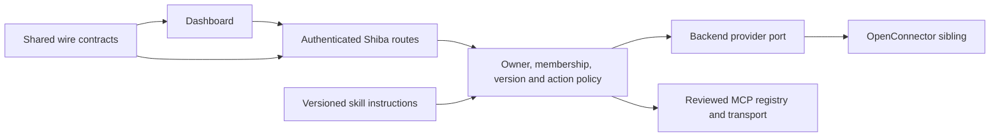

# Integration package boundaries

Shiba uses one OpenConnector adapter and one reviewed external MCP registry. The dashboard must call those actual runtimes; a shared schema, catalog card or database table does not establish an execution path. [Readiness and setup](integrations-readiness.md) distinguish inventory from configured accounts.

| Owner | Responsibility | Excluded responsibilities |
| --- | --- | --- |
| `packages/shared` (`@shiba/shared`) | Pure TypeScript/Zod request/response schemas, catalog IDs, readiness states and employee/skill contracts. | Cloudflare bindings, provider clients, secret values, application imports or network effects. |
| `apps/backend/src/integrations` | Backend provider port, OpenConnector adapter and injected fetch transport. | Browser state and presentation. |
| Backend routes, MCP gateway and employee tools | Verify requesting identity; derive owner aliases; validate connections, resources, versions, grants and exact action approvals. | Treating occupational labels, catalog status or skill instructions as authority. |
| `apps/frontend` | Typed canonical clients, connection/setup UI and actor-scoped request state. | Direct upstream admin/runtime calls, secret storage or alternate mock registries in normal operation. |
| `packages/sdk` | Generated public API types and client; build-time OpenAPI consistency checks. | Backend runtime implementation or provider credentials. |
| Pinned OpenConnector sibling | Independently deployed upstream Worker, its own storage, encryption and OAuth callback. | Sharing Shiba's D1, provider tokens or permission authority by package import. |
| `infra/openconnector.mjs` and deploy workflows | Explicit preparation, configuration and deployment of the sibling and host bindings. | Automatic credentials, client registration, consent or service installation during an app build. |

Provider credentials stay in backend Worker bindings or encrypted server records. The frontend receives readiness and safe account metadata. The sandbox receives managed-provider placeholders; server egress attaches credentials only after the approved route and resource checks. A skill supplies instructions and cannot grant a tool, account or approval.

Private OpenConnector connections are selected by the authenticated owner's server-derived alias. They are not workspace-shared accounts. A workspace-visible MCP record similarly does not authorize another actor to use its credentials: execution still intersects the registered tool, workspace, actor, membership, employee grants and current version. Unsupported schemas and transports remain unavailable.

The existing provider port stays backend-local because it currently has one service consumer. Reusable wire contracts already belong in `@shiba/shared`; moving the adapter into a new public package would add a dependency edge without a second runtime consumer. A future adapter package must expose an injected transport and secret-free contract, with credentials and authorization supplied by its server caller.

Builds remain separate from provisioning. `pnpm build` compiles application assets and validates documentation; it does not deploy OpenConnector or accept vendor terms. TypeScript project references, source import lint, SDK generation checks, backend HTTP fixtures and browser journeys verify the boundaries. Tests are deliberately uncached. Real OAuth, provider actions and remote MCP compatibility require configured authorized services and separate live acceptance.
