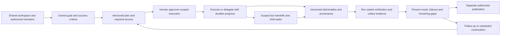

# AI employees: product and acceptance contract

The binding product goal combines a Viktor-like AI employee experience with an
Overlay-like shared workspace and bot collaboration. Employees should carry
owned goals through planning, scoped work and verified durable results, while
people and bots can share context, delegate tasks, hand off outputs and review
parent/child progress inside a workspace. This is a combined target, not
equal-weight 1:1 parity with three products; ReasonMachines remains a reference
source rather than a third equally weighted target.

The repository now includes role templates, bounded required-file capture for
approved-repository runs, and coding subagent primitives. The tested Marketing
journey is useful partial progress; it does not complete the employee and
workspace-collaboration goal. A catalog, template, connected CLI, single
subagent route or successful chat response is **partial progress**, not
completion.

The existing [Bot acceptance](../audits/bots-e2e.md) and
[working-state recheck](../audits/final-recheck.md) provide a tested software
engineering foundation. They explicitly use deterministic model/execution
fixtures and do not establish live inference or general business-role execution.
The broader [Overlay comparison](../audits/overlay-reference.md) remains a
source-based comparison with its own evidence limits.

## Required employee experience

An employee has a durable identity, responsibilities, instructions, a versioned
configuration, allowed resources/tools, model/runtime bindings and a readiness
state with concrete reasons. Hiring or configuring one does not start work. A
shared workspace has explicit membership, access and human ownership. A goal
records its owner and lead employee; its tasks record the person or bot
responsible for each item. People and bots can collaborate on a shared goal
without merging their identities or permissions. One employee can retain
several independent conversations; a run remains one execution attempt, not the
employee or the entire goal.

For an assigned goal, the product must support:

This is a **required product flow**, not a diagram of a completed runtime.
Publishing is optional. A useful verified draft can satisfy a draft-only goal
without sending, posting, deploying or changing an external system.

### Goal and plan

- The goal records the owner/workspace, employee identity/configuration version,
  requested outcome, relevant source materials, deliverable formats, success
  criteria and execution limits. Marketing or research must not require a fake
  GitHub repository merely to enter a coding executor.
- The plan identifies tasks, dependencies, expected outputs, verification,
  required connections and any proposed delegation. Missing access produces an
  actionable blocked state; it never becomes a fictional completed task.
- Plan revisions and questions remain visible. Changing the approved scope,
  resources, recipients, cost limits or action types invalidates prior authority
  for the changed work and requires the appropriate new approval.
- The owner can review, edit, reject or approve a specific plan version. The UI
  distinguishes planning, awaiting approval, running, blocked, verifying,
  awaiting review, failed, cancelled and completed outcomes. These are product
  states to implement consistently, not a declaration that the existing run
  status enum already provides a goal state machine.

### Shared workspace and bot collaboration

- Workspace membership and sharing are explicit. A human owner can assign a
  goal to a lead bot, assign child tasks to people or bots, and see each task's
  owner, status and relationship to the parent goal. A conversation or run is
  not a substitute for that shared ownership record.
- A bot handoff carries the approved task, relevant shared context, expected
  outputs, scope, permissions and budget. The recipient can report progress,
  ask for clarification or return a blocked/failed result; the parent goal
  retains the handoff and returned output with clear provenance.
- Parent and child state stays visible across refresh and restart. Results,
  failures, retries and cancellation are linked to their originating tasks. A
  parent cannot present its goal as complete while required child work remains
  unresolved or its result has not been reviewed.
- Shared context and retained outputs are available only to authorized
  workspace members. Source references, decisions and output versions stay
  attached to the goal or task that used them; retrieving shared context cannot
  broaden a bot's access.
- Each child inherits no more authority than its parent plan grants. Repository,
  service, publication and budget limits follow the delegation. Required human
  approval precedes execution, and authorized reviewers can inspect the parent
  plan, child assignments, permission requests, outputs and evidence before
  accepting, rejecting or reassigning work.
- Acceptance exercises a multi-bot goal with at least two assigned tasks,
  shared but scoped context, a handoff and returned durable output, visible
  parent/child state, review, a blocked or failed child, cancellation/retry,
  refresh/restart, and denied cross-workspace access. The current coding
  subagent path does not establish this complete collaboration journey.

### Approved execution and delegation

- Each task uses its authorized tool/resource set and the selected employee's
  effective frozen configuration. A delegated worker cannot acquire broader
  authority than its parent. Declining a plan starts no sandbox or task mutation.
- Durable task attempts record inputs, run IDs, configuration/plan versions,
  status, tool calls, approvals, errors and output references. Progress survives
  refresh and process restart. A spinner or an open process is not completion.
- Retry identifiers survive transient failure. Ambiguous external outcomes are
  reconciled before repeating an action. Cancellation fences the complete
  delegated tree and prevents late results or pending approvals from reviving
  cancelled work.
- Tools use configured service bindings. Unsupported actions fail explicitly;
  a model may not simulate success by inventing a file, message ID, citation or
  remote action receipt.

### Durable deliverables and verification

Every promised deliverable must be retrievable after refresh/restart, belong to
the correct owner/workspace/goal and contain an identifiable version. The
contract requires its type, title, content/storage reference, producing task,
source/provenance references and verification result. The current run-deliverable
feature captures only files required by an approved run, keeps their bodies in
private R2, and offers authenticated downloads after checking the recorded byte
count and SHA-256. This provides a bounded durable output for a run, but not the
full employee-level artifact and provenance model described above.

Examples include a code patch and test report, a campaign brief and copy bundle,
a cited comparison with a source table, or an operations report and proposed
action list. Screenshots and model prose can supplement evidence, but cannot
substitute for the promised output or an actual action receipt.

Verification is matched to the goal and reports PASS, FAIL, PARTIAL, BLOCKED or
NOT VERIFIED with supporting evidence. Failed or unrun checks are visible.
An employee must not mark itself complete solely because its model said it was
done. Critical criteria require executable checks, inspected outputs or explicit
human acceptance, with unknowns distinguished from measured zero/success.

### Publication and follow-up

Draft creation, task execution and publication have separate authority. A
publication request binds the exact deliverable version/content digest,
destination, account, operation and permitted effect. Editing that version
requires fresh authority for the new content. Repeated clicks/retries must not
send duplicate mail, create duplicate posts, publish twice or repeat a mutation.

Follow-up reuses authorized context and retained deliverables with clear
version lineage. A recurrence has an owner, cadence, scope, budget, stop
conditions, failure/retry policy and an off switch. It cannot silently turn a
draft-only goal into permission to publish or expand access.

## Role-specific end-to-end acceptance

The roles below are product responsibilities. They are not aliases for the
existing `AGENT_ROLES` coding vocabulary or proof that new runtime tools exist.

| Role | Representative goal and durable result | Minimum acceptance | Current source-evidence status |
| --- | --- | --- | --- |
| Coding employee | Fix an approved repository issue; retain patch, changed-file list, test output and a factual result summary. | Approve the frozen repository/task/config; clone and execute through the authorized runtime; inspect actual diff; run relevant checks; retain result after reload; reject/cancel without continued execution. A PR/deploy is separately authorized. | **PARTIAL.** `agents/orchestrator.ts`, `runs.ts`, `runtime.ts`, sandbox adapters and `scripts/shiba-local-daemon.mjs` implement substantial execution/approval/result machinery. The recheck records real local Git/file/diff/permission/cancellation behavior with a deterministic model CLI; live model/provider execution remains NOT VERIFIED. |
| Marketing employee | Produce a campaign brief, audience/message plan, channel-specific copy and an editorial calendar from supplied product/brand facts. | No invented product claims; cite supplied facts; validate requested channels/formats and required sections; preserve editable/versioned drafts after reload; show review and explicit publication destinations. Failure or missing facts produces questions/blocked work. No posts or emails are sent during draft acceptance. | **PARTIAL.** The repository Marketing template and required-file workflow passed in browser and sandboxed Linux Electron: 14 UI steps and 18 protocol checks on each target. Both used native Git/filesystem, Worker, Durable Objects, D1 identity, private R2 capture/download and the actual approval flow. The model CLI was a deterministic fixture (`liveInference: false`). A missing required campaign file failed the run without exposing a partial bundle. This verifies bounded capture and journey behavior, not live inference, semantic accuracy/effectiveness, analytics, a general business workspace or publication. |
| Research employee | Compare selected options against stated constraints; retain a report, source table and evidence/caveat list. | Fetch/read only permitted sources; retain URLs, access dates and claim-to-source references; separate quotations, inference and unavailable sources; verify cited claims against retrieved material; update a report without losing prior versions. A blocked URL is not a negative finding about the vendor. | **PARTIAL.** A Research repository template requests a report and source JSON, and required-file capture checks presence, text validity and JSON syntax. A research-specific end-to-end journey has not been accepted: permitted source retrieval, citation accuracy, claim verification and versioned updates remain unverified. `v1/mcp.ts` also lacks an upstream MCP registry. |
| Operations employee | Triage an authorized inbox or supplied operational events; produce a status report, prioritized action list and reply/task drafts. | Restrict reads to allowed mailboxes/resources; retain source IDs and proposed actions; approval gates sends/deletes/other mutations; handle revoked access, duplicate events and transient failure; follow-up schedule is visible and stoppable. External changes require separately authorized, idempotent action receipts. | **PARTIAL.** An Operations repository template and required runbook output are implemented, alongside reusable mail, approval, trigger and orchestrator tools in `mcp-email-tools.ts`, `inbox-routes.ts`, `email-approvals.ts`, `automations-do.ts` and `codemode.ts`. No executed evidence establishes an integrated employee goal through authorized triage, report verification and controlled follow-up. |

Source presence in this table does not establish live capability. All four
repository role templates exist, but only the Marketing workflow has the
executed role-specific acceptance described above. A catalog showing all four
role names, or a template with required paths, is **partial** until each full
journey passes.

## Current reusable foundations and missing common layer

| Common capability | Current evidence | Required remaining behavior |
| --- | --- | --- |
| Employee identity and conversations | Versioned custom profiles, owner-scoped named sessions, bot association, archive/restore and profile/approval provenance were implemented in the Bot work. See `custom-agents-store.ts`, `sessions-routes.ts` and the lifecycle/browser evidence. | Shared workspace membership, human/bot goal and task ownership, employee readiness and goal views need a coherent product surface. Do not conflate an MCP client principal, a bot definition, a conversation and a run. |
| Planning and general tools | `codemode.ts` can expose registered email/memory/run tools to the orchestrator through `run_code`, with a network-isolated WorkerLoader and tool scope/audit checks. Approved runs also freeze their required file paths into the approval payload. | There is no demonstrated shared goal/task ownership ledger or versioned plan and deliverable lineage across employees and people. Freezing an approved run's required files does not provide workspace collaboration or per-employee resource/permission isolation; the existing shared `orchestrator-agent` principal remains shared. |
| Delegation and execution | Coding run lineage, approval evidence, cancellation fencing and local/cloud execution seams exist. `den/spawn.ts` mints children only under an active parent with an approved budget and depth cap; `v1/subagents.ts` exposes caller-visible persisted lineage, child state and stored task/final-summary projections. | These are bounded coding subagent primitives, not a shared multi-bot workspace workflow. General task types, explicit context handoffs, retained shared outputs, coherent parent/child goal state and reviewer controls remain to be established. Delegation budgets and permissions must follow the goal. |
| Memory and context | Per-agent facts, a deployment-shared registry, Vectorize integration and MCP memory tools exist in `memory-do.ts` and `mcp-memory-tools.ts`. | Employee/workspace visibility and provenance must be explicit. Intentional shared account memory cannot be assumed safe for unrelated tenants or silently treated as private employee knowledge. Live retrieval remains separately unverified. |
| Files and artifacts | Runs now capture only approved required repository files, retain bounded bodies in private R2, expose metadata in run results, and provide authenticated owner/conversation-scoped downloads with byte-count and SHA-256 verification. Required paths are frozen before human approval; a missing or invalid required file fails the run and does not expose a partial bundle. The Marketing web and Linux Electron acceptance is recorded in [the deliverables audit](../audits/employee-deliverables.md). | This is run-scoped capture, not shared workspace output: there is no goal-level version/revision lineage, title/type and source-provenance record, general file upload/ingestion, or role-specific semantic validator. General uploads/ingestion are not implied by R2. |
| Connections and readiness | Supported provider, GitHub, mailbox and selected integration paths exist; `integrations-routes.ts` explicitly reports `liveVerified: false` for its metadata/self-tests. | Each required action needs a usable scoped binding and functional readiness proof. A present secret, connected icon or connection name does not prove successful access. Unsupported providers/actions remain unavailable. |
| Standing goals and follow-up | `automations.ts` includes schedules/triggers, a mission flag and `customAgentId`; durable queue/retry/accounting fixes exist. | That mission flag is not a general employee success-criteria/plan/artifact state machine. A recurring employee workflow needs inspectable previous results, bounded authority and stop conditions tied to the goal. |
| Verification and publication | Coding tests/diff checks and explicit run/email approvals supply useful patterns. | General role verification and content publication need version-bound authority and read-backs for their actual destinations. Existing coding publication options do not grant marketing/operations publishing rights. |

## Safety and authorization invariants

The repository's [AGENTS.md](../../AGENTS.md) remains load-bearing:

- No sandbox starts before the required human approval. A role template or
  legacy automatic-approval setting cannot waive it.
- Model/subscription credentials stay outside the coding sandbox at the egress
  boundary; existing supported local CLI authentication stays on its approved
  paired machine. Neither design grants general token access to employee tools.
- Git access is restricted to the approved repository. Business employee actions
  require their own resource/destination scope rather than reusing Git authority.
- Connected subscription lanes retain their supported authentication semantics;
  a gateway token is not invented as a universal prerequisite.

Business-role tools must also reject cross-owner/workspace access, scope
escalation through retrieved content, revoked connections and unapproved
external effects. Documents, web pages and email bodies are untrusted inputs,
not instructions that can widen employee authority.

## Product target and reference evidence

The selected product target is Viktor-like AI employee depth combined with
Overlay-like shared workspace and bot collaboration. The three references are
not equal-weight 1:1 targets. `reasonmachines.com` remains a contextual
reference if relevant evidence becomes available. These target labels describe
the requested direction; they are not claims about features observed in the
live products. The separate pinned `LayerNorm/overlay-web` source checkout
provides only source evidence from its inspected revision.

The requested live product references remain inaccessible in this environment:

| Reference | Evidence currently available | Limitation |
| --- | --- | --- |
| `https://getoverlay.io` | The coordinator's HTTP GET in the current comparison attempt returned proxy HTTP 403. The separate pinned `LayerNorm/overlay-web` source checkout was inspected earlier. | The live product and authenticated workflows were not observed. Source defaults do not prove deployed settings, product behavior or complete live parity. |
| `https://reasonmachines.com` | The coordinator's HTTP GET in this attempt returned proxy HTTP 403. | No verified product feature baseline or authenticated journey is available. Features must not be invented from the domain name or marketing assumptions. |
| `https://viktor.com` | The coordinator's HTTP GET in this attempt returned proxy HTTP 403. | No verified product feature baseline or authenticated journey is available. Features must not be inferred from another product or a similarly named service. |

These are observed access failures, not evidence that the sites are down or
their advertised capabilities are missing. This document does not claim to
have bypassed the proxy, entered an account or tested those services.

## Evidence required before calling the combined goal complete or claiming 1:1 parity

Completion requires all of the following, rather than a successful catalog
build or one fixture-driven coding test:

1. **Concrete baselines for the selected dimensions:** accessible product
   documentation/source, authorized read-only access, or user-supplied current
   demonstrations for Viktor-like employee workflows and Overlay-like shared
   workspace/bot collaboration. Record observed versions/dates, workflows,
   permission models and disabled/optional features. ReasonMachines may inform
   context, but is not an equal-weight acceptance target. Never request account
   secrets in chat.
2. **A behavior-level acceptance matrix:** map selected employee and
   collaboration behaviors to Shiba UI, APIs, storage, tools, failure handling
   and executed checks. Mark absent, unavailable and unverified behavior
   explicitly. Matching names or visual cards is insufficient.
3. **Four complete employee-role journeys and a collaboration journey:** each
   role needs goal, plan, scoped approval, actual
   execution/delegation, durable deliverables, verification, review and follow-up
   on the final integrated revision. Marketing/research/operations must not be
   relabeled coding prompts. The collaboration journey must exercise shared
   workspace ownership, scoped context, bot handoffs, retained outputs,
   parent/child state, permissions, human review, failure, cancellation,
   refresh/restart and denied cross-workspace access. Success, rejection,
   duplicate retry and revoked-access cases need meaningful evidence.
4. **Honest execution boundaries:** fixtures establish local contracts only.
   Live employee claims require at least the supported configured runtime/model
   and role-required service operations to be exercised with retained evidence.
   Real payments, sends, posts, deployments and other external mutations remain
   separately authorized and are not prerequisites for a draft-only goal.
5. **Operational acceptance:** scoped storage/credentials, audit trail,
   cancellation/recovery, bounded costs/work, usable accessibility, regression
   gates and the selected deployment/backup/restore/release checks. A saved
   environment configuration is not a published or deployed application.
6. **No hidden substitutions:** do not weaken tests, replace live work with
   fabricated receipts, call absent artifacts complete, present unknown usage
   as free, or label a partial role template implementation full parity.

Until these checks are satisfied, the accurate status is **partial
implementation; the combined AI employee and workspace-collaboration goal and
1:1 product parity are not established**.
There is no fabricated completion timeline in this contract.
