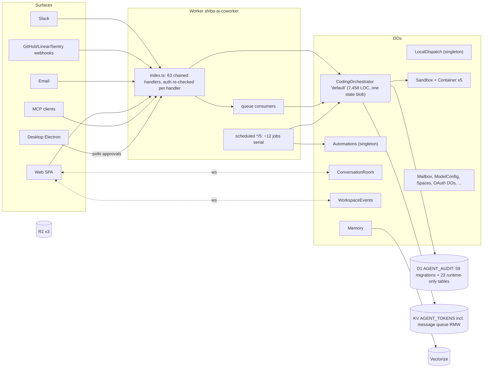
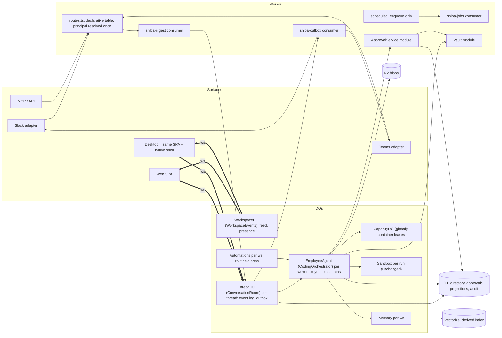
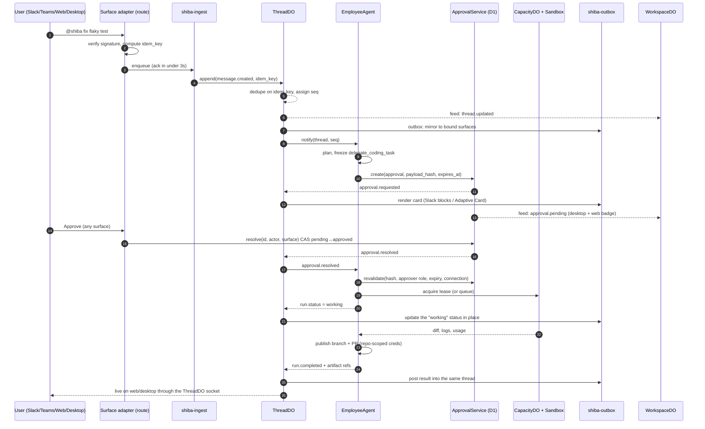
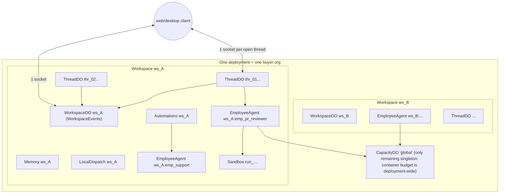

# Shiba target architecture and migration plan

Status: proposal · Date: 2026-11-17 · Baseline: `opentoolsorg/shiba@4bc346f2` (facts from the read-only review)

> **Review status (second pass, checked against `4bc346f2` itself).** The counts in the brief hold: 59 migrations with head `0060`, `orchestrator.ts` 7,458 LOC, `index.ts` 764, all named files exist. But this draft proposes several things the repo already has, so these parts **need rework before anyone builds from them**:
>
> - **Tenancy (§13, M12, M13):** `team_workspaces`, `team_workspace_memberships` (owner/admin/member), invitations and groups already exist, keyed by `(tenant_id, workspace_id)`. `WorkspaceEvents` is already keyed by workspace. Extend these; do not add `workspaces` / `ws_default`.
> - **Thread model (§5, M14–M16):** D1 already has `collaboration_rooms`, `collaboration_messages`, `collaboration_slack_room_links`, `collaboration_reply_claims`, `collaboration_slack_delivery_intents` and `collaboration_presence`. `orchestration/event-log.ts` and `outbox.ts` already define a sequenced event log and effect outbox (stored inside `OrchestratorState`). `ConversationRoom` is keyed per run (`ownerId`, `sessionId`) or per collaboration room, not per thread.
> - **Approvals (§8, M19):** `workspace_app_approvals` already has `input_hash`, `expires_at` and a decision role. The backfill must also cover orchestrator instances other than `"default"`.
> - **Orchestrator (§7.1, M24, M25):** only four files hardcode `"default"`. Other callers address `CodingOrchestrator` by user id, agent name or chat thread key, so there are many instances to migrate and drain, not one.
>
> Vault, signing key, route table, cron-to-queue, CapacityDO, logging, schema guards and the deploy path are unaffected.

---

## 1. Summary

Keep one Worker, the five security invariants, the sandbox adapters, D1, R2 and the test suite. Replace the parts that block the north star.

Each deployment belongs to one buyer and holds one or more **workspaces**. Every conversation, whether it starts in Slack, Teams, the web app or the desktop app, becomes one **thread**. The thread is an ordered event log in its own Durable Object (the existing `ConversationRoom`, grown into that role). Each surface is an adapter that writes events into the log and renders events back out. A **workspace DO** (the existing `WorkspaceEvents`) handles presence and the live feed, so the desktop app stops polling.

The 7,458-line orchestrator is split into an **employee agent** for each workspace and employee. Its state moves out of one JSON blob into SQLite tables. A global **capacity DO** shares out the 5 containers. All seven approval code paths go through **one approval service**, backed by D1 with a compare-and-set resolve.

The cron job only enqueues work. Each workspace's routines run on alarms in its Automations DO. Credentials move into one vault with key ids and rotation. Routing moves to one declarative table with an auth mode per route. Prod, dogfood and PR previews all deploy through alchemy.

Every step is additive first (dual-write or dual-read), cuts over second and deletes last, so each one can be rolled back.

---

## 2. Keep, change, throw away

**Keep as-is**
- The five security invariants and the nine-step run lifecycle. They're the product. Nothing below weakens them.
- `packages/sandbox`: the registry, the contract tests and the four adapters. Capacity control goes *around* it, not into it.
- The `IntegrationProvider` interface, the action input policy and the operator-authority model in `apps/backend/src/integrations/`.
- D1, R2, Queues with DLQs, hibernatable WebSockets, and SQLite-backed DOs.
- **DO class names.** Renaming a DO class needs a `renamed_classes` migration and buys nothing, so `ConversationRoom` keeps its name and becomes the thread DO. The new role names in this doc are aliases.
- **Both `0036_*` migration files.** D1 tracks applied migrations by file name. Renumbering one would re-apply it on prod. Leave both and add a CI rule so it can't happen again.
- The test culture: about 98k test LOC, roughly 1:1 with source.

**Change**
- `orchestrator.ts`: split it (ADR-05). Most of the code survives as modules. The state blob does not.
- The 63 chained route handlers: put them in one table (ADR-12). The handler bodies survive.
- `ConversationRoom` and `WorkspaceEvents`: they grow into the thread DO and the workspace DO (ADR-03, ADR-04).
- Crypto in 8 files: route it through one vault (ADR-11). Existing ciphertext stays readable without rewriting it.

**Throw away**
- `OrchestratorState` as a capped JSON blob. `slice(-300)` silently drops runs and approvals. That's data loss dressed up as a cap.
- Runtime `CREATE TABLE IF NOT EXISTS` for D1, in 33 files. Two schema sources means prod's schema is whatever code happened to run first.
- KV read-modify-write (`v1-message-queue.ts`, the rate window in `oauth-mcp.ts`). KV is eventually consistent, so this loses writes by design.
- The `MODEL_CREDENTIAL_KEY` fallback for signing in `child-dispatch.ts`.
- `apps/desktop/src/approvals-poller.ts`, after one release with WebSockets.
- `collaboration-store.ts` (v1), `wrangler.noroutes.tmp.jsonc` and `wrangler.dogfood.jsonc`, plus the hardcoded PR 188 in `preview-deploy.yml`.
- The "default" singleton pattern for anything holding per-workspace state.
- `effect` as a half-adopted second programming model. 7 of 548 files is a tax, not a direction. Freeze it now and remove it as those files are touched (see open question Q11).

---

## 3. Diagrams

### 3.1 Current state



### 3.2 Target state



### 3.3 Cross-surface event flow



### 3.4 DO topology



Per-user DOs (`ChatGptAuth`, `UserProviderOAuth`) stay keyed by user. `ModelConfig` and `Spaces` get workspace keys in M13. `Waitlist` and `Mailbox` keep their current keys.

---

## 4. Domain model and store ownership

**Ownership rule.** D1 owns anything listed or queried across a workspace, and anything that must outlive a DO being re-keyed. DO SQLite owns ordered, high-write logs and hot per-entity state. R2 owns blobs. Vectorize owns nothing: it is a derived index and can always be rebuilt. KV holds only write-once data with a TTL (OAuth state, short-lived token caches).

| Entity | Source of truth | Projections and indexes | Id | Replaces or changes |
|---|---|---|---|---|
| Workspace | D1 `workspaces` | — | `ws_<ulid>`; backfilled `ws_default` | New (M12) |
| Member | better-auth `user` + D1 `workspace_members(workspace_id, user_id, role)` | — | better-auth user id | `packages/auth/src/better-auth.ts` unchanged; membership is new |
| External identity | D1 `identities(provider, provider_tenant, external_id → member_id, verified_via, linked_at)` | — | composite PK | New. Replaces ad-hoc Slack user lookups in `slack-*` |
| Employee | D1 `employees` (template, model ref, tool policy, skills, version, status `draft/active`) | Working memory in EmployeeAgent DO | `emp_<ulid>` | Employee drafts move out of `OrchestratorState` |
| Thread | **ThreadDO** SQLite `events`, `bindings`, `outbox` | D1 `threads(workspace_id, title, last_seq, last_event_at, status)` for lists and search | `thr_<ulid>` | `ConversationRoom` grows into it; Slack canvas maps move to `bindings` |
| Message | ThreadDO event (`message.*`) | Search projection is open (Q8). Attachments in R2 `ATTACHMENTS` | `evt_<ulid>` | `v1-message-queue.ts` (KV) is retired |
| Task | D1 `tasks` (mutable: assignee, status, board order) | `task.*` events in its thread | `tsk_<ulid>` | The existing `0036_team_work_tasks` table becomes it (add columns, no rename) |
| Run | **EmployeeAgent** SQLite `runs`, `run_steps` | D1 `runs` summary (status, timings, cost, parent_run_id) | `run_<ulid>` | `OrchestratorState.runs`, review rounds, PR bindings |
| Approval | **D1 `approvals`** (CAS resolve) | `approval.*` events in ThreadDO and WorkspaceDO | `apr_<ulid>` | `OrchestratorState.pendingApprovals` and the 7 approval files |
| Routine | D1 `routines` (trigger, schedule, budget, owner employee) | Next fire time as an alarm in the workspace's Automations DO | `rtn_<ulid>` | Singleton `Automations`; `automation tick` in cron |
| Skill | D1 `skills` (name, version, content hash, scope) | Body in R2 `FILES` | `skl_<ulid>@v` | `skill-library/` folder becomes the loader |
| Memory item | **Memory DO per workspace** SQLite (text, scope, owner, source, ttl, deleted_at) | Vectorize `MEMORY_VECTORS` with metadata `{ws, scope, owner}` | `mem_<ulid>` | Memory DO re-keyed from global to per workspace |
| Connection | D1 `connections` (provider, scopes, owner, workspace, status) + vault ciphertext | — | `con_<ulid>` | Credential rows across the 8 crypto files |
| Artifact | R2 `ARTIFACTS` + D1 `artifacts(run_id, thread_id, kind, r2_key, sha256)` | — | `art_<ulid>` | Unchanged storage; the metadata table is new |
| Audit event | D1 `audit_events`, append-only | — | ulid | Existing audit tables; pruning moves to a job |
| Usage | D1 `run_usage(run_id, kind, model, tokens_in/out, container_ms, cost_micros, price_version)` | — | — | New |

**Task vs run.** A task is what a human asked for. A run is one attempt by one employee to do it. A task has zero or more runs, and subagents are child runs. Today these are blurred inside `OrchestratorState`.

---

## 5. Cross-surface thread and event model

### 5.1 Event envelope (in `packages/shared/src/thread-events.ts`)

```ts
type ThreadEvent = {
  seq: number;              // assigned by ThreadDO, gapless per thread
  eventId: string;          // evt_<ulid>
  idemKey: string;          // source-derived, unique per thread
  threadId: string;
  workspaceId: string;
  type: "message.created" | "message.edited" | "message.deleted"
      | "task.created" | "task.updated"
      | "run.queued" | "run.status" | "run.completed" | "run.failed"
      | "approval.requested" | "approval.resolved" | "approval.expired"
      | "artifact.created" | "binding.added";
  actor: { kind: "member"; memberId: string }
       | { kind: "external"; provider: "slack" | "teams"; externalId: string } // not linked yet
       | { kind: "employee"; employeeId: string; runId?: string }
       | { kind: "system" };
  surface: "slack" | "teams" | "web" | "desktop" | "email" | "api" | "routine";
  causationId?: string;     // the eventId that caused this one
  sourceTs?: string;        // the surface's own timestamp, for display only
  payload: unknown;         // zod schema per type
};
```

### 5.2 Idempotency keys

| Source | `idemKey` |
|---|---|
| Slack Events API | `slack:{team_id}:{event_id}`. Retries carry the same `event_id`, so `X-Slack-Retry-Num` needs no special handling. |
| Slack interactivity | `slack:{team_id}:act:{trigger_id}`. `action_ts` plus `user_id` can collide on fast double clicks. The approval CAS is the real guard anyway. |
| Teams activity | `teams:{tenant_id}:{activity.id}` |
| Web and desktop | `web:{clientMsgId}` (a ulid the client generates and reuses on retry) |
| Email | `email:{Message-ID}` |
| Routine fire | `rtn:{routine_id}:{scheduled_at}` |

ThreadDO enforces `UNIQUE(idem_key)`. A duplicate append returns the existing `seq` and is not an error. Webhook routes ack fast and enqueue. The dedupe happens at the DO, which is the only place that is strongly consistent. Today KV approximates this.

### 5.3 Ordering

- **Total order within a thread** comes from DO `seq`. There is no order across threads, and none is needed.
- Display order is `seq`, not the surface's timestamp. `sourceTs` is metadata.
- An event that refers to an external message the DO hasn't seen yet (for example, a Slack edit that arrives before the create) is parked. The queue retries it with backoff, and after 5 attempts it goes to the DLQ and an audit record.

### 5.4 Thread bindings and mirroring

- D1 `thread_bindings(provider, provider_tenant, external_key) → thread_id`, with a unique key. For Slack, `external_key = channel:thread_ts`. For Teams it is `conversation.id` plus the reply chain id. A web thread has no binding until someone shares it to a channel.
- **Outbox:** every event a bound surface should see becomes an `outbox` row in the ThreadDO. The `shiba-outbox` consumer delivers it and stores the external message id, which makes Slack `chat.update` and Teams `updateActivity` possible, and that is how the "working" status updates in place. Delivery is idempotent: if an external id exists, the consumer updates the message instead of posting a new one.
- **Echo suppression:** inbound events whose author is our bot (Slack `bot_id`, Teams `from.id == app id`), or whose external id matches an outbox row, are dropped before append.

### 5.5 Identity mapping

- `identities` links `(provider, tenant, external_id)` to a member. There are three ways to link:
  1. **Self-link (default):** an unlinked user sees "Connect your Shiba account" and signs in on web. The link is written with `verified_via = oauth`.
  2. **Sign in with Slack or Microsoft (Entra):** the OIDC `sub` maps directly.
  3. **Admin-approved email match:** off by default. It is allowed only when both emails are verified and the domain is on an allowlist.
  Option 3 never links automatically. An admin confirms each link one by one, because Slack email verification is controlled by the Slack admin, and a Teams `upn` or email address can change.
- **Teams link key:** Teams identities are keyed on `tid` plus `oid`, never on `upn` or email.
- **Unlinked external users can chat (the employee answers read-only) but cannot start a consequential run or approve one.** Their request becomes a *proposed task* that a linked member must adopt. The run then executes with the adopting or approving member's authority:
  - it uses workspace BYOK and that member's permitted connections
  - it never uses anyone's personal subscription login
  - the audit log records both the external requester and the accountable member

  That keeps per-surface auth and "approval before execution" intact once there are several surfaces.

---

## 6. Realtime and multiplayer

- **WorkspaceDO** (`WorkspaceEvents`, keyed by `workspaceId`). Each client holds one socket to it. It carries the feed (thread list changes, pending approvals, run status summaries) and presence. The feed has its own `feedSeq`, and the last N=1,000 entries are kept in DO SQLite.
- **ThreadDO** (`ConversationRoom`, keyed by `threadId`). It holds one socket for each open thread view and carries full events, typing indicators and "employee is working" status.
- **Why two levels and not one DO per workspace:** a single workspace DO would serialize every message of every thread, which makes a hot spot exactly where the multiplayer pitch is. Per-thread DOs scale out, and the workspace DO only carries summaries.
- **Presence** is ephemeral and never persisted: `{memberId, surface: web|desktop, viewingThreadId?, state: active|idle, lastSeen}`. It is stored with `serializeAttachment` so it survives hibernation. Attachments are size-limited (about 2 KiB), so store only ids and the state enum, never profiles. Clients heartbeat every 30s. A ThreadDO reports its viewers to the WorkspaceDO so the thread list can show avatars. Employee presence is derived from run status. Slack and Teams presence is not mirrored (open question Q9).
- **Reconnect and backfill:** the client stores `lastSeq` per socket and sends `{type:"resume", since}`. If `since` is within the retained window, the DO replays `seq > since` up to 500 events. Otherwise it sends `{type:"reset"}`, and the client fetches a snapshot over HTTP (D1 projection plus the last page of events) and resumes from there.
- **The desktop app** is the same SPA (`apps/frontend` already contains `desktop-provider.ts` and `desktop-status.ts`) with native extras: tray, notifications, `LocalDispatch` pairing. It subscribes to the WorkspaceDO feed, and an `approval.pending` event triggers a native notification. `approvals-poller.ts` stays one release behind `SHIBA_DESKTOP_POLL_FALLBACK` and is then deleted.
- **Frontend:** a single `thread-store` fed by ThreadDO events replaces `collaboration-store.ts`, `collaboration-v2-store.ts`, `conversation-room-realtime.ts` and `collaboration-room-realtime.ts`, and `state/workspace-events.ts` becomes the feed client.

---

## 7. Agent runtime and sandboxes

### 7.1 Splitting `orchestrator.ts`

The target layout is under `apps/backend/src/agents/employee/`:

| Module | Takes from `orchestrator.ts` | State goes to |
|---|---|---|
| `employee-agent.ts`: the Think class, still exported as `CodingOrchestrator` | planning loop, tool registry wiring, prose → `delegate_coding_task` | DO SQLite |
| `runs/state-machine.ts` (pure) | the run steps ingress…cleanup | `runs`, `run_steps` tables |
| `runs/repo.ts` | — | DO SQLite + D1 `runs` projection |
| `approvals/` (moved to the top-level service) | `pendingApprovals`, frozen-input logic | D1 `approvals` |
| `surfaces/slack/canvas.ts` | Slack canvas maps | ThreadDO `bindings` |
| `github/pr-bindings.ts`, `github/review-rounds.ts` | PR bindings, review rounds | D1 `pr_bindings`, `review_rounds` |
| `sandbox/reaper.ts` | leaked containers | CapacityDO leases |
| `idempotency.ts` | `commandReceipts` | DO SQLite `receipts(key PK, result, expires_at)` |
| `web-sessions` | web sessions | removed: covered by auth sessions and ThreadDO sockets |
| `employees/drafts.ts` | employee drafts | D1 `employees` with `status='draft'` |

There are two moves, done in order and never at once:
1. **Blob to tables inside the same `"default"` instance.** Nothing gets re-keyed, so routing doesn't change. Each list is dual-read: the table first, falling back to the blob.
2. **Re-key** to `${workspaceId}:${employeeId}`. New runs start on new instances. The `"default"` instance drains: in-flight runs finish where they started, because each run row records its `agentInstance` and resolution looks that up. Once it is empty, `"default"` is read-only for one release and is then left in place with its data, never deleted.

### 7.2 Subagents and background workers

- **A subagent is a child run** with `parent_run_id`. There are three kinds:
  - `think`: in-process, with no sandbox, for read-only work such as research and summarizing.
  - `sandbox`: a container, for coding work.
  - `opencode`: the existing `OpenCodeAgent`.
- **A child never inherits approval for a consequential action.** Each child action gets its own frozen approval unless the parent's approved payload explicitly lists it. The budget is inherited and decremented.
- **Background workers are queue consumers.** `shiba-ingest`, `shiba-webhooks` and `shiba-email` stay. Two are added: `shiba-outbox` (surface delivery) and `shiba-jobs` (system jobs). There is no new runtime.
- `child-dispatch.ts` stays as the signed hop between them. Its signing is fixed in M06.

### 7.3 Container budget

- **The `CapacityDO("global")` singleton is justified** because the resource is deployment-wide (max 5 containers). Its state is tiny: `leases(run_id, workspace_id, acquired_at, heartbeat_at)`.
- `acquire` succeeds only if the total number of leases is below `SHIBA_MAX_CONTAINERS` (default 5, read from the same value alchemy sets). The global cap is never exceeded.
- Within the cap, waiters are admitted round-robin by workspace. When there are more active workspaces than slots, some workspaces simply wait.
- A run that can't be admitted becomes `run.queued` with a visible position, and the DO wakes waiters on release.
- **Portable fallback:** the same class runs on workerd (ADR-16).
- A lease expires after 3 missed heartbeats (90s). The reaper alarm ends the container through the Sandbox adapter. This replaces the "leaked containers" list.
- **Local fact to check:** wrangler 4.140 rejects `max_instances` on DO-managed containers. The local `wrangler.jsonc:235` says the cap lives in `vars.INSTANCE_TYPE` plus the alchemy `Container`. The budget has to come from one variable that both alchemy and the CapacityDO read.

### 7.4 Sandbox portability

`packages/sandbox` doesn't change. Capacity, leases and reaping sit above the adapter interface, so Docker, E2B and ComputeSDK get the same budget logic for free. Add one contract test: an adapter `destroy()` must be idempotent, because the reaper may call it twice.

---

## 8. Approvals

Approvals become one module, `apps/backend/src/approvals/` (service, policy, repo, renderers). The 7 current files become thin surface handlers that call it:

| Current file | Becomes |
|---|---|
| `approvals-routes.ts`, `collaboration-approval-routes.ts` | Web/API handler calling `ApprovalService.resolve` |
| `slack-approval.ts` | Slack adapter `parseApprovalAction` + `renderApprovalCard` |
| `email-approvals.ts` | Email adapter (signed single-use link, then resolve) |
| `pr-publish-approval.ts` | An approval `kind` (`pr.publish`), not a separate flow |
| `pending-approvals.ts` | `ApprovalService.list` (D1 query) |
| `approval-resolve-auth.ts` | `approvals/policy.ts` |

**Table:** `approvals(id, workspace_id, thread_id, run_id, kind, risk, payload_json, payload_sha256, requested_by, requested_via, status pending|approved|rejected|expired|consumed, decided_by, decided_via, decided_at, expires_at, consumed_at, policy_version)`.

- **Frozen input:** `payload_json` is canonical JSON with sorted keys, and `payload_sha256` is computed at creation. The card shows a rendering of exactly that payload.
- **Resolve:** `UPDATE approvals SET status=?, decided_by=?, … WHERE id=? AND status='pending' AND expires_at > now`. If no row changed, it was already decided or expired. That check is idempotent across surfaces, so a double click in Slack and on web at the same moment is safe.
- **Revalidation at dispatch:** the dispatcher **recomputes** `sha256(canonical(actual tool input about to execute))` and compares it with the stored `payload_sha256`. It never trusts a stored hash on its own. It then re-reads the row and checks all of the following:
  - the recomputed hash matches
  - the status is `approved` and not yet `consumed`
  - the approver is still a member with the required role
  - the referenced connection or repo is still allowed
  - it has not expired

  It then marks the row `consumed` with a CAS update. Consumption is single-use.
- **Expiry:** the default is 24h, configurable per kind. A `shiba-jobs` sweep sets expired rows to `expired` and emits `approval.expired`. The run moves to `blocked`, and a human can re-request.
- **Who may approve:** `policy.ts` maps `(kind, risk)` to a minimum role (`owner|admin|member`), plus an optional four-eyes rule that stops the requester approving their own request. Defaults:
  - read-only connector actions: no approval
  - writes to a connector, opening a PR, sending email: `member`
  - publishing to the default branch, deleting things, spending money: `admin`, four-eyes when more than one admin exists

  Unlinked external identities cannot approve anything.
- **Single authority from day one:** from M19a, D1 is the **only** store that decides. The legacy handlers (Slack action, email link, web) forward to `ApprovalService.resolve`. The blob's `pendingApprovals` is never read for a decision again. It is only written to, as an audit mirror, until M24.
  - Rollback therefore never puts the blob back in charge. A flag only switches the *rendering and handler code* back to the legacy files, which still call the service.
  - This removes the double-dispatch window that comes with two deciding stores.
- **Backfill:** the `"default"` DO gets a backfill method that is reached only through the DO stub. There is no HTTP route for it. It is called by a one-shot `shiba-jobs` job, and the job message is signed with `INTERNAL_SIGNING_KEY` (the `internal-signed` mode).
  - It returns approval metadata and the frozen payload only, never credentials.
  - Pending rows keep their ids, so cards already in Slack keep working.
  - The method is covered by the route and invariant tests like any other entry point.

---

## 9. Scheduler and routines

- **System jobs.** `scheduled()` stops running jobs. It enqueues one `shiba-jobs` message per job with `idemKey = job:{name}:{windowStart}`. The consumer runs each job on its own, with retries, the DLQ and per-job timeouts. A slow HubSpot read can no longer delay Slack ticks.
  - Job names: `founder.stripe`, `founder.meta`, `founder.hubspot`, `reconcile`, `slack.tick`, `routines.reconcile`, `drafts.sweep`, `audit.prune`, `approvals.expire`, `vault.rotate`, `capacity.reap`, `memory.retention`.
- **Routines** (for each workspace):
  - Definitions live in D1 `routines`.
  - The workspace's `Automations` DO (re-keyed from a singleton to `workspaceId`) keeps one alarm set to the next fire time across its routines.
  - When the alarm fires, the DO appends `rtn:{id}:{scheduledAt}` to the routine's thread, so every routine has a home thread and its output lands in Slack or Teams through bindings. It then starts `AutomationRunWorkflow` (existing).
  - Event triggers (a webhook arrives, a connector event) enqueue the same way.
  - `routines.reconcile` in cron re-arms any alarm that is missing. That covers the cases where an alarm is lost or deploys race.
- **Budgets:** each routine has `max_runs_per_day`, `max_cost_micros_per_day` and `max_container_minutes`, checked before start against `run_usage`. Going over the budget leaves the routine paused and emits a thread event. It never fails silently.
- **Retries:** the Workflow step retries handle transient failures. The routine's run is marked `failed` after the final attempt. Routines never retry consequential actions automatically, because those need a new approval.
- **Portable fallback:** Workflows is Cloudflare-only. `AutomationRunWorkflow` steps must stay plain async functions with explicit checkpoints in DO SQLite, so a DO-alarm runner can replace Workflows on a non-Cloudflare server (open question Q2).

---

## 10. Memory and knowledge

- **Scopes:** `workspace` (shared facts), `employee` (what one employee learned, such as repo conventions) and `user` (preferences, visible only to that member and the employees acting for them). Each item carries `owner_id` (employee or member) and `source` (thread event, routine, manual, import).
- **Store:** the Memory DO for each workspace is the source of truth. Vectorize is a derived index with metadata filters `{ws, scope, owner}`. Every query filters on `ws`, and on `owner` for the user scope. Deny-by-default applies here too.
- **Why not Vectorize as the source:** it can't do transactions or exact deletes with read-after-write, and it's Cloudflare-only. **Portable fallback:** a brute-force cosine scan in DO SQLite, which is fine up to roughly 50k items per workspace, or `sqlite-vec` on a server.
- **Retention:** a TTL per scope (default: workspace never, employee 365d, user 365d). A soft delete sets `deleted_at` and removes the vector at once. A hard purge comes 30 days later through `memory.retention`. When a member is deleted, all of that user's scoped items are purged right away.
- **Re-index:** `memory.reindex` rebuilds Vectorize from DO SQLite. It is used when the embedding model changes and in disaster recovery.

---

## 11. Integrations

- **OpenConnector is the long tail:** embed it, pin it, never host it.
  - Pin an exact version in `packages/openconnector-read-gateway/package.json` and in `infra/openconnector*.mjs`, with Renovate disabled for it and upgrades as reviewed PRs.
  - Keep it inside the buyer's deployment. Never expose an endpoint that serves connector calls to third parties.
  - Add a route-table lint so no `public` route proxies to the gateway. That keeps the "no hosted connector service" licence rule enforceable, not just intended.
- **Native integrations where they matter:** Slack, Teams, GitHub and Gmail.
  - Native integrations are a **SurfaceAdapter** (a conversation surface) or a **NativeProvider** (behind `IntegrationProvider`), never both concerns in one file.
  - `SurfaceAdapter`: `verifyInbound`, `toThreadEvents`, `bindingKey`, `render(event) → native message`, `updateInPlace`, `renderApprovalCard`, `parseApprovalAction`, `typing`. It has two real implementations (Slack and Teams), so the interface is justified.
- **Founder integrations** (`founder-*`, 66 files covering Stripe, Meta and HubSpot): move them into `apps/backend/src/extensions/founder/` with no behavior change. Convert their cron jobs into routines on the founder workspace. Where OpenConnector has parity, migrate the reads to it. These are dogfood features, not the product's core, and they shouldn't shape the core architecture (open question Q6).

### 11.1 Microsoft Teams

**Recommendation: Bot Connector for the conversation, and Graph with resource-specific consent (RSC) only for context.**

| Need | Mechanism |
|---|---|
| Receive @mentions and replies | A Bot messaging endpoint `POST /webhooks/teams`. Validate the inbound JWT with `jose` (already a dependency at 6.2.12): issuer, audience equal to the app id, keys from the Bot Framework OpenID metadata, and the `serviceUrl` claim. |
| Post, update, typing | Bot Connector REST against the stored `serviceUrl` with a client-credentials token. Use `updateActivity` for the "working" status and a typing activity while thinking. |
| Approval cards | Adaptive Cards with `Action.Execute`. An invoke activity maps to `parseApprovalAction`, which calls `ApprovalService.resolve`, and the card is refreshed in place. |
| Proactive posts (routine output) | A stored `ConversationReference` in `thread_bindings` |
| Read channel history and files for context | Graph with RSC (`ChannelMessage.Read.Group`), scoped per team and granted at install |
| Identity link | Entra OIDC sign-in, with the `oid` stored in `identities` |
| Buyer setup | The buyer registers their own Entra app and Azure Bot and installs a Teams app manifest zip, just as Slack works with `slack-app-manifest.yaml`. The manifest is generated by a script. |

- **Reuse:** Teams is a second `SurfaceAdapter`. Everything after `toThreadEvents` is shared with Slack: ThreadDO, the employee, approvals and the outbox. My *estimate*, not measured, is about 2,500 LOC against Slack's 5,873, because the event model already exists by then. The M31 PR (a) spike should re-estimate it.
- **Avoid Node-heavy Microsoft SDKs** inside the Worker. Write a thin REST client over `fetch` and `jose`.
- **Verify before building:** the Bot Framework SDK has been superseded by the Microsoft 365 Agents SDK, and there have been changes to registering multi-tenant bots. The wire protocol is what matters here, so confirm both against current Microsoft docs (Q7).

---

## 12. Providers and credentials

- **Two credential classes in one vault:**
  - **BYOK** belongs to the workspace. Any employee can use it, subject to policy.
  - **Subscription logins** (Codex, Claude, Cursor, Antigravity, ChatGPT) belong to a person. By default they are used only for runs that person starts or approves. Shared routines use BYOK. This matters both for provider terms and for audit (Q5).
- **Vault** (`apps/backend/src/vault/`) replaces the hand-written AES-GCM in 8 files:
  - Ciphertext format: `v1.{kid}.{purpose}.{iv_b64url}.{ct_b64url}`. `kid` and `purpose` must match `[a-z0-9-]+`, and base64url contains no `.`, so the string parses unambiguously.
  - Keys: `SHIBA_VAULT_KEYS` is a JSON object `{kid: hex64}`, and `SHIBA_VAULT_ACTIVE_KID` names the active one.
  - **Legacy:** a value without the `v1.` prefix decrypts with kid `legacy` = `MODEL_CREDENTIAL_KEY`, using the *exact* HKDF info and salt each of the 8 files uses today. Those are captured as named purposes, with golden-vector tests built from real ciphertext samples on dogfood and never from prod.
  - **Rotation:** add a kid and switch the active one. Reads accept any known kid. `vault.rotate` re-encrypts rows lazily on write, plus a batched sweep. A kid is removed only after a query shows zero rows still use it.
- **Signing:** `INTERNAL_SIGNING_KEY` becomes required.
  - Release N: if the key is missing, the deploy check warns. The verifier accepts signatures from both the new key and the legacy derived key, and the signer uses the new key whenever it exists.
  - Release N+1: deploy fails without the key, and the legacy verify is removed. Child-dispatch signatures are short-lived, so the overlap window is minutes.

---

## 13. Tenancy

**Decision: both, with a clear boundary.** One deployment serves one buyer organization, which is the security boundary. Inside it there are 1..n **workspaces**, which are the authorization and data-scoping boundary.

- **Not hosted multi-tenant SaaS.** The container pool, egress proxy and vault key are shared per deployment. That's acceptable between teams of one company and not acceptable between strangers. Keep `ARCHITECTURE-AS-BUILT.md`'s "single-tenant" wording, but redefine it as "single *organization*". Make that edit in M12.
- **Data model changes either way:**
  - `workspace_id` on every D1 table holding user data, added as `NOT NULL DEFAULT 'ws_default'`. SQLite `ALTER TABLE ADD COLUMN` with a constant default doesn't rewrite the table.
  - Every DO that holds per-workspace state is keyed by workspace.
  - Every Vectorize query filters on `ws`.
  - Every R2 key is prefixed `ws/{id}/` for new writes. Old keys stay valid through a metadata lookup and are not moved.
- Doing this before launch is cheap. Retrofitting it after customers have data is the expensive kind of migration.

---

## 14. Security and routing

- **The five invariants are unchanged.** Each one gets a named test file under `apps/backend/test/invariants/` that the route table and the approval service must keep green.
- **`apps/backend/src/http/routes.ts`** is one array of entries:

  ```ts
  { method, pattern: URLPattern, auth: AuthMode, rateLimit?: "mcp"|"auth"|"upload", handler }
  ```

  where `AuthMode` is one of:

  ```ts
  "public" | "session" | "access-jwt" | "session-or-access"
  | "bearer:mcp" | "bearer:local" | "oauth:mcp"
  | "webhook:slack" | "webhook:teams" | "webhook:github" | "webhook:linear"
  | "webhook:discord" | "webhook:telegram" | "webhook:sentry" | "internal-signed"
  ```

  Other rules:
  - `URLPattern` is native in Workers, so no router dependency is needed.
  - The principal is resolved **once** in `http/auth.ts` (built out of `request-auth.ts`) and passed as `ctx.principal`. That replaces identity resolution in 48 files.
  - A request matching no route gets a 404. Exempt paths no longer count as "authenticated"; they get an explicit `public` mode.
  - A test asserts that every route has a mode and that no `public` route reaches the vault, approvals or the OpenConnector gateway.
  - `OPEN_DASHBOARD=1` becomes one `public` static route that is only allowed when `stage !== "prod"`.
- **Order-preserving migration:** first wrap all 63 handlers as `{ auth: "legacy" }` in their current order, which changes nothing. Then convert them group by group. `legacy` is deleted when the count reaches zero, and CI fails if the count goes up.

---

## 15. Observability

- **`apps/backend/src/obs/log.ts`:** JSON lines with `{level, msg, ts, stage, workspaceId, threadId, runId, approvalId, traceId}`, with the context carried through `AsyncLocalStorage` (it works in Workers with `nodejs_compat`). Turn Biome `noConsole` on as an error, with an allowlist for `obs/`. Replace all 158 calls mechanically in one PR.
- **Traces:** each run has a `traceId`, and each run step logs `span.start` and `span.end` records. On Cloudflare, Workers Logs and Observability ingest these as they are. A buyer can set `SHIBA_OTLP_ENDPOINT` to export them to any OTLP collector, which is the portable path. There's no call home and no default exporter.
- **Audit:** the D1 `audit_events` table is append-only. It records every approval transition, credential use (the kid, never the value), outbound connector write, PR publish and role change. Pruning runs through `audit.prune` with a configurable retention (default 400 days).
- **Cost per run:** `run_usage` rows are written at each model call and container release. `price_version` points at `packages/shared/src/pricing.ts`, which is versioned in the repo so old cost totals don't change when prices do. The thread shows cost on `run.completed`. Subscription calls record tokens with `cost_micros = 0` and `billing = "subscription"`.

---

## 16. Testing and preview environments

- **One deploy path:** `alchemy.run.ts`, driven by `--stage prod|dogfood|pr-<N>`. A stage maps to a Worker name, D1, routes, secrets source and container cap. `wrangler.dogfood.jsonc` and `wrangler.noroutes.tmp.jsonc` are deleted. `wrangler.jsonc` stays only as alchemy's binding source if it needs one; otherwise it is generated.
  - **Risk:** alchemy is `2.0.0-beta.80`. Pin it, and keep a documented `wrangler deploy` fallback for prod until alchemy reaches 2.0 GA.
- **Previews:** take the PR number from `github.event.pull_request.number` and remove the hardcoded 188.
  - Note that `preview-deploy.yml` and `scripts/deploy-preview*.mjs` have uncommitted changes in the local tree, so coordinate with whoever owns them.
  - Each preview gets its own D1 seeded from fixtures, never from prod. It gets its own Slack dev app or a disabled Slack surface, a container cap of 1, and teardown on PR close.
- **Migration rehearsal (`.github/workflows/migration-rehearsal.yml`, manual):**
  1. `wrangler d1 export` prod into an artifact. This is read-only against prod.
  2. Import it into a scratch D1, `shiba-rehearsal-<run>`.
  3. Apply the pending migrations.
  4. Run `scripts/schema-snapshot.mjs`, then the backfill scripts in `--dry-run` and then for real.
  5. Run the invariant and acceptance suites against a Worker bound to the scratch D1.
  6. Destroy the scratch D1.

  Every migration PR links a green rehearsal run.

  **The default source is a dogfood export.** A prod export is opt-in and needs maintainer approval each time. It is encrypted, expires after 24h, and never leaves the operator's own CI.

  For self-hosting buyers, the same workflow runs in *their* CI against *their* data. Nothing is ever sent to us.
- **Schema guards in CI:**
  - unique migration prefixes, with the `0036` pair allowlisted
  - no `CREATE TABLE` against `AGENT_AUDIT` outside `migrations/`, with a shrinking allowlist
  - a schema snapshot diff on every PR that touches `migrations/`
- **DO state migrations:** each DO keeps a `schema_version` in its own SQLite and migrates in `blockConcurrencyWhile` on first access. Tests cover upgrading from a fixture of every prior version.

---

## 17. ADRs

ADRs are written out as files under `apps/web/docs/adr/` in M00. Condensed here.

### ADR-01: Tenancy is one organization per deployment, with many workspaces
- **Context:** the as-built doc says "single-tenant by contract". The north star needs teams, and buyers have several teams.
- **Options:** (a) one workspace per deployment; (b) hosted multi-tenant; (c) one org per deployment with many workspaces.
- **Decision:** (c).
- **Tradeoffs:** a `workspace_id` everywhere, plus workspace-keyed DOs. There is no hostile-tenant isolation, and that is stated in the docs.
- **Reversal cost:** low going to (a), since everything just sits in `ws_default`. Very high going to (b), which would need isolated pools and per-tenant keys. Not planned.

### ADR-02: Store ownership rules (section 4)
- **Options:** (a) D1 for everything; (b) DO SQLite for everything; (c) the split rule in section 4.
- **Decision:** (c).
- **Tradeoffs:** projections can lag the DOs. Each projection carries `last_seq`, so its writes are idempotent and can be repaired.
- **Reversal cost:** medium per entity.

### ADR-03: The thread is a canonical event log in a per-thread DO
- **Context:** Slack, web and desktop each keep their own message state. There's no shared model, and KV RMW loses messages.
- **Options:** (a) D1 `events` table plus polling; (b) one DO per workspace for all events; (c) a DO per thread (grown out of `ConversationRoom`).
- **Decision:** (c).
- **Tradeoffs:** listing and searching across threads needs the D1 projection. Each open thread costs one socket.
- **Reversal cost:** medium. The events are append-only and can be exported to D1.

### ADR-04: Workspace DO for presence and the feed; WebSockets replace desktop polling
- **Options:** (a) keep polling; (b) SSE; (c) hibernatable WebSockets, which already exist.
- **Decision:** (c), plus a poll fallback for one release.
- **Tradeoffs:** reconnect and backfill logic in the client.
- **Reversal cost:** low.

### ADR-05: Split the orchestrator into an employee agent per (workspace, employee)
- **Context:** 7,458 LOC, one state blob, capped lists that drop data, the "default" singleton.
- **Options:**
  - (a) keep the singleton and only move state into tables
  - (b) a DO per run
  - (c) a DO per employee, with runs as tables inside it
  - (d) (a) first, then (c)
- **Decision:** (d). Keep the class name `CodingOrchestrator`.
- **Tradeoffs:** one employee serializes its own planning, which is fine since the slow parts are model calls and containers. A run is pinned to the instance it started on.
- **Reversal cost:** after step 1, low. After re-keying, medium (route by `agentInstance`).

### ADR-06: Run state in the employee DO; a global CapacityDO for containers
- **Options:** (a) Workflows for runs; (b) DO tables plus alarms; (c) a D1 job table.
- **Decision:** (b). It is portable through a workerd self-host profile (Q2) and keeps the approval wait cheap.
- **Tradeoffs:** we own the step runner.
- **Reversal cost:** medium.

### ADR-07: One approval service on D1 with a CAS resolve
- **Options:** (a) approvals in DO SQLite per thread; (b) D1.
- **Decision:** (b). Cross-surface "my approvals" lists and policy checks are relational, and a single-row CAS is atomic in D1 and in any SQL store.
- **Tradeoffs:** one D1 round trip per decision.
- **Reversal cost:** low.

### ADR-08: Cron enqueues only; routines run on per-workspace alarms
- **Options:** (a) keep serial cron; (b) one Workflow per job; (c) a queue fan-out for system jobs plus DO alarms for routines.
- **Decision:** (c).
- **Tradeoffs:** two mechanisms, but each fits its job: system jobs are fixed and global, routines are user-defined and per workspace.
- **Reversal cost:** low.

### ADR-09: Memory has its source of truth in DO SQLite; Vectorize is derived
- **Decision:** as in section 10.
- **Tradeoffs:** a write goes to two stores, and the index is eventually consistent.
- **Reversal cost:** low, because the index is rebuildable.

### ADR-10: Surface adapters; Teams through Bot Connector plus Graph RSC
- **Options:** (a) Graph-only (change notifications); (b) Bot Connector; (c) (b) plus RSC Graph for context.
- **Decision:** (c). Graph change notifications need subscription renewal and don't give an interactive bot experience.
- **Tradeoffs:** the buyer has to register Azure resources.
- **Reversal cost:** low, limited to the adapter.

### ADR-11: Credential vault with key ids; a separate signing key
- **Options:** (a) keep per-file crypto; (b) a vault module with kid prefixes and legacy read; (c) an external KMS.
- **Decision:** (b). A KMS would be a cloud dependency the buyer may not have; it stays optional later behind the same interface.
- **Tradeoffs:** we own the crypto code. That's mitigated by golden vectors and by using WebCrypto only.
- **Reversal cost:** low. Legacy read stays forever.

### ADR-12: A declarative route table with one auth mode per route
- **Options:** (a) keep the handler chain; (b) adopt Hono; (c) our own `URLPattern` table.
- **Decision:** (c). No new dependency, and it can be adopted gradually through the `legacy` mode.
- **Tradeoffs:** we own the matching, which is small.
- **Reversal cost:** low.

### ADR-13: D1 migrations are the only schema source; never renumber
- **Decision:** consolidate the runtime DDL into migrations using DDL captured from prod. CI guards enforce it.
- **Reversal cost:** n/a.

### ADR-14: One deploy path through alchemy stages
- **Options:** (a) wrangler for everything; (b) alchemy for everything; (c) keep four paths.
- **Decision:** (b), with a pinned version and a documented wrangler escape hatch for prod.
- **Tradeoffs:** a beta dependency on the deploy critical path.
- **Reversal cost:** medium, because the stage config would have to be regenerated as wrangler files.

### ADR-15: Structured logs, traces per run, cost per run, with no call home
- **Decision:** as in section 15. OTLP export is opt-in and set by the buyer.
- **Reversal cost:** low.

### ADR-16: Portability profile
- **Context:** the plan is "Cloudflare first, any server second". DOs, Queues, Workflows, Vectorize and Containers are all Cloudflare services.
- **Decision:** the portable target is **workerd** (which runs DOs with on-disk SQLite), the Docker sandbox adapter, SQLite in place of D1, a DB-backed job table in place of Queues, DO alarms in place of Workflows, SQLite cosine search in place of Vectorize, and the filesystem or S3 in place of R2.
- **Rule:** every new Cloudflare-only binding has to sit behind a small interface with one in-repo fallback.
- **Status:** the feasibility of D1 and Queues under workerd is unverified (Q2), so nothing ships on this profile before a spike.

---

## 18. Migration plan

**Conventions:**
- Each step is one PR under about 2,000 lines, unless marked "stack".
- Merge commits only.
- **Launch** marks a step that must land before launch.
- "Preview" means `https://shiba-pr-<N>.<account>.workers.dev`, or the alchemy route.
- Migration numbers `0061`+ assume `0060` is the head at `4bc346f2` (the local checkout's head is `0037`). M00 confirms the real head before any migration PR is numbered.
- Steps on Queues, Workflows or Vectorize use the portable fallbacks named in ADR-16.
- Every data step links a green migration rehearsal.

The general pattern for each data step:
1. Additive migration (new tables or columns, nothing dropped).
2. Dual-write.
3. Backfill script, idempotent, with `--dry-run`.
4. Read cut-over behind a flag.
5. One release soak.
6. Stop the old writes.
7. A cleanup PR at least one release later.

Rollback before step 6 means turning the flag off. After step 6, rollback means re-enabling the old writes from a new backfill. Old data is never deleted in the same release that stops writing it.

### Phase 0: Guardrails (no behavior change)

**M00: Baseline re-check and ADR files.** Launch
- **Files:** `apps/web/docs/adr/0001…0016-*.md`, `ARCHITECTURE-AS-BUILT.md` (orchestrator LOC, the tenancy wording)
- **Size:** about 800 lines, docs only
- **Depends on:** nothing
- **Acceptance:** the docs check in CI passes. Every file path in this proposal exists at the target commit, or a note says where it moved.
- **Data and rollback:** none.

**M01: Single preview path.** Launch
- **Files:** `.github/workflows/preview-deploy.yml`, `alchemy.run.ts`, `scripts/deploy-preview.mjs`, `scripts/deploy-preview.test.mjs`
- **Size:** about 300 lines
- **Depends on:** nothing
- **Acceptance:** opening a PR deploys `shiba-pr-<that N>`, and `/health` returns its commit SHA. Closing the PR tears the stage down. The preview's D1 is seeded from fixtures, its container cap is 1, and Slack is off unless `SHIBA_PREVIEW_SLACK_APP` is set.
- **Data:** none. **Rollback:** revert the workflow.

**M02: Schema guards and migration rehearsal.** Launch
- **Files:** `scripts/check-migrations.mjs` (unique prefixes, `0036` allowlist, no new runtime DDL), `scripts/schema-snapshot.mjs`, `.github/workflows/migration-rehearsal.yml`, `ci.yml`
- **Size:** about 600 lines
- **Depends on:** nothing
- **Acceptance:** the rehearsal workflow runs on a prod export, applies the migrations to a scratch D1, prints the schema diff, and destroys the scratch D1. CI fails on a duplicate prefix or a new `CREATE TABLE` in `src/`.
- **Data:** a read-only prod export. **Rollback:** revert.

**M03: Structured logger.** Launch
- **Files:** `apps/backend/src/obs/log.ts`, `biome.json` (`noConsole`), and the 158 call sites
- **Size:** about 1,400 lines, mechanical
- **Depends on:** nothing
- **Acceptance:** preview logs in Workers Logs are JSON and carry `requestId`. A Slack mention on the preview produces log lines all sharing one `threadId`.
- **Data and rollback:** none; revert.

**M04: Flag registry.**
- **Files:** `apps/backend/src/config/flags.ts`, `.env.schema` (varlock), plus a lint rule banning `env.SHIBA_*` reads outside the registry. The 41 flag reads are converted.
- **Size:** about 900 lines
- **Depends on:** nothing
- **Acceptance:** `GET /api/admin/flags` on the preview (admin only) lists all 41 flags with source and value. `pnpm env:load` validates them.
- **Data and rollback:** none.

### Phase 1: Security foundations

**M05a: Vault, read path only.** Launch
- **Files:** `apps/backend/src/vault/{vault,purposes,legacy}.ts`. The 8 crypto files decrypt through the vault, which reads both legacy and `v1.` ciphertext. Writes stay legacy. Tests include golden vectors.
- **Size:** about 1,100 lines
- **Depends on:** M03
- **Acceptance:** on a preview seeded with legacy ciphertext from fixtures, existing BYOK and subscription credentials still work: a model call succeeds. A fixture `v1.` row also decrypts.
- **Data:** none.
- **Rollback:** revert is safe, because no `v1.` rows exist yet.

**M05b: Vault, write `v1.`.** Launch
- **Files:** the vault encrypt path, the flag `SHIBA_VAULT_WRITE_V1`, removal of the per-file fallback
- **Size:** about 300 lines
- **Depends on:** M05a, plus one release in prod
- **Acceptance:** new credential saves on the preview produce `v1.<kid>.…`. Turning the flag off makes new saves legacy again, and both kinds still decrypt.
- **Data:** new writes only.
- **Rollback:** turn the flag off. **Never revert M05a after this ships.**

**M06: Separate signing key.** Launch
- **Files:** `child-dispatch.ts`, the deploy check, `.env.schema`
- **Size:** about 250 lines
- **Depends on:** M04
- **Acceptance:** a preview without `INTERNAL_SIGNING_KEY` logs a warning and still dispatches. With the key set, signatures verify, and legacy signatures are accepted until N+1.
- **Data:** none. **Rollback:** revert. The dual-verify window keeps in-flight messages valid.

**M07: Key rotation job.**
- **Files:** `vault/rotate.ts`, the `vault.rotate` job
- **Size:** about 450 lines
- **Depends on:** M05b plus one release, and M28
- **Acceptance:** on a preview, add kid `k2` and make it active. The rotation job reports `rows_remaining → 0`, the old kid's usage count reaches 0, and credentials still work.
- **Data:** an in-place re-encrypt per row, done as a CAS on the old ciphertext.
- **Rollback:** keep the old kid configured, and reads keep working.

**M08: Route table skeleton.** Launch
- **Files:** `apps/backend/src/http/{routes,auth,match}.ts`, `index.ts` (fetch becomes the table), with all 63 handlers as `legacy` in their current order
- **Additional files:**
  - `test/routes-auth-snapshot.test.ts`, which records the **effective** auth of every path today, including the paths `request-auth.ts` exempts
  - the `OPEN_DASHBOARD` prod guard
- **Size:** about 1,100 lines
- **Depends on:** M03
- **Acceptance:**
  - The full existing test suite passes unchanged.
  - The snapshot test proves that unauthenticated requests get the same status for every route before and after.
  - Unknown paths return 404 from day one.
  - `OPEN_DASHBOARD=1` is refused when `stage=prod`.
  - A smoke script on the preview covers login, an MCP call and a Slack URL verification.

  `legacy` routes are inside the snapshot, so they are covered by the "no public route reaches the vault, approvals or gateway" check from M08 on.
- **Data:** none. **Rollback:** revert.

**M09: Route group conversions.** Launch for a–c. Stack of four PRs:
- **(a)** webhooks (Slack, GitHub, Linear, Discord, Telegram, Sentry)
- **(b)** `/mcp`, `/api/local` and the MCP OAuth endpoints
- **(c)** `/api/*` session routes
- **(d)** static, public and `OPEN_DASHBOARD`
- **Files:** `request-auth.ts` (shrinks), `approval-resolve-auth.ts`, the handler files (identity resolution removed from the 48 files)
- **Size:** about 800–1,500 lines each
- **Depends on:** M08
- **Acceptance:** an invariant test per mode. On the preview, a request without auth to each converted route gets 401 or 403. A Slack request with a bad signature gets 401. The `legacy` count drops in each PR.
- **Data:** none. **Rollback:** revert one PR.

**M10: Stop the KV damage now; one queue cut-over later.** Launch
- **Files:**
  - `oauth-mcp.ts`: the rate window moves to the existing `MCP` rate-limiter binding (portable fallback: an in-DO counter)
  - `v1-message-queue.ts`: failed KV writes now return errors instead of success
- **Size:** about 300 lines
- **Depends on:** M08
- **Acceptance:** on the preview, a forced KV write failure shows as an error in the UI and the logs. The MCP rate limit still triggers at the configured threshold.
- **Data:** none. **Rollback:** revert.
- **Note:** the queue itself is **not** moved here. It moves once, straight to the ThreadDO, in M15 and M18. An interim DO queue would add a second cut-over that could lose messages.

### Phase 2: Schema and tenancy

**M11: Consolidate runtime DDL into migrations.** Launch. Stack of two PRs.
- **Files:**
  - `migrations/0061_runtime_tables.sql`: `CREATE TABLE IF NOT EXISTS` for each of the 23 runtime-only tables, with DDL **copied from prod's `sqlite_master`** (a read-only query) and not from the code, plus a CREATE for every index found
  - DDL removed from the 33 files
- **Size:** about 1,800 lines
- **Depends on:** M02
- **Acceptance:**
  - The rehearsal shows no schema diff on the prod copy.
  - A fresh preview D1 built from migrations alone matches the snapshot.
  - The guard's allowlist reaches zero.
- **Release rule:** both PRs of the stack ship **in the same release**. The migration applies before the Worker that no longer has runtime DDL. That way no deployed code ever creates one of these tables with a different shape.
- **Data:** none, because `IF NOT EXISTS` is a no-op where the tables already exist. If prod's DDL differs from the code (because a runtime ALTER drifted), the migration follows **prod**, and a follow-up migration fixes the drift on purpose.
- **Rollback:** revert the code. The tables stay, which is harmless.

**M12: Workspaces, members, identities.** Launch
- **Files:**
  - `migrations/0062_workspaces.sql` (`workspaces`, `workspace_members`, `identities`, seeded with `ws_default`)
  - `apps/backend/src/workspaces/`
  - backfill: every existing user becomes a member of `ws_default`, with the role decided by Q3
  - `ARCHITECTURE-AS-BUILT.md` gets the tenancy wording
- **Size:** about 1,100 lines
- **Depends on:** M09c
- **Acceptance:** on the preview, `/api/me` returns `workspaces:[ws_default]`. An admin can create a second workspace and invite a member. A non-member gets 403 on the second workspace's routes.
- **Data:** an additive backfill.
- **Rollback:** the flag `SHIBA_WORKSPACES=0` hides the feature, and the tables stay.

**M13: `workspace_id` on user-data tables.** Launch. Stack of two or three PRs, grouped by domain.
- **Files:**
  - migrations: `ALTER TABLE … ADD COLUMN workspace_id TEXT NOT NULL DEFAULT 'ws_default'`, plus indexes
  - query sites get a `workspace_id` predicate
  - `ModelConfig`, `Spaces`, `Memory`, `Automations` and `LocalDispatch` get workspace keys, while reads fall back to the old singleton key
- **Size:** about 1,500 lines each
- **Depends on:** M12
- **Acceptance:** on the preview, data created in `ws_B` is invisible from `ws_default` on every list endpoint (a contract test runs per endpoint). Existing data is visible in `ws_default`.
- **Data:** the column default does the backfill. DOs are copied once, with a single writer at all times:
  1. On first access, the workspace instance runs `blockConcurrencyWhile`. It calls the singleton's `exportAndFreeze(workspaceId)`.
  2. Inside its own `blockConcurrencyWhile`, the singleton sets `frozen[ws]=true`, returns the data, and from then on rejects writes for that workspace with a "moved" error that callers retry against the new instance.
  3. The workspace instance writes the data and a `migrated_from` marker.

  A second concurrent first access waits on the gate and then sees the marker.
- **Rollback:**
  - The column is ignored by old code, so it's safe.
  - For DOs, the flag routes back to the singleton and calls `unfreeze` with the delta: the workspace instance exports any rows written since the copy. This has to be tested in the rehearsal before the flag is ever flipped in prod.

### Phase 3: Thread and event model

**M14: Event envelope and the thread event log.** Launch
- **Files:**
  - `packages/shared/src/thread-events.ts` (types and zod)
  - `conversation-room-do.ts`: `events`, `bindings` and `outbox` tables, an `append()` RPC, `schema_version`, and a backfill from its current message tables into events
  - `migrations/0063_threads.sql` (the `threads` projection and `thread_bindings`)
- **Size:** about 1,600 lines
- **Depends on:** M13
- **Acceptance:** on the preview, sending a message from web creates an event with `seq`. A reload returns the same `seq` list. Re-posting with the same `clientMsgId` doesn't create a duplicate.
- **Data:** an in-DO migration copies existing room messages into `events` and keeps the old tables.
- **Rollback:** the old tables are still written (dual-write) until M17.

**M15: Slack ingress through the thread log.** Launch
- **Files:** `slack-events*.ts` routes, the `shiba-ingest` consumer, `thread_bindings` writes. The existing Slack path keeps working, and the event is also appended (dual-write).
- **Size:** about 1,300 lines
- **Depends on:** M14
- **Acceptance:** on the preview with its Slack dev app, an @mention appears in the web thread live within 2s. Replaying the same Slack payload three times produces one event.
- **Data:** none. **Rollback:** the flag `SHIBA_THREAD_LOG_SLACK=0`.

**M16: Outbox and the Slack SurfaceAdapter.** Launch. Stack of two PRs.
- **PRs:** (a) the adapter interface and moving the `slack-*` render code; (b) the outbox consumer, update in place and echo suppression.
- **Files:** `surfaces/slack/*` (from the 25 `slack-*` files), `surfaces/types.ts`, the `shiba-outbox` queue in `alchemy.run.ts`
- **Size:** about 1,500 + 1,200 lines
- **Depends on:** M15
- **Acceptance:** a reply typed on web appears in the Slack thread. The "working" status updates in place, as one message rather than many. No echo loop: a test checks that the event count stays flat after 10s.
- **Data:** none. **Rollback:** the flag returns to the legacy direct Slack posts.

**M17: Frontend thread-store.** Launch
- **Files:**
  - `apps/frontend/src/state/thread-store.ts`
  - replace `collaboration-store.ts`, `collaboration-v2-store.ts`, `conversation-room-realtime.ts` and `collaboration-room-realtime.ts`
  - desktop uses the same store
- **Size:** about 1,800 lines
- **Depends on:** M14 and M21
- **Acceptance:** two browsers and the desktop app on the preview see the same thread. A message typed in one appears in the others within 1s.
- **Data:** none. **Rollback:** the flag `SHIBA_UI_THREAD_STORE=0` keeps the v2 store for one release.

**M18: Retire the KV message queue.**
- **Files:** delete `v1-message-queue.ts`. The ThreadDO append (with the `UNIQUE(idem_key)` constraint) is the queue.
- **Size:** about −500 lines
- **Depends on:** M17 plus one release
- **Acceptance:** a test fires 50 concurrent messages at one thread on the preview, and all 50 land exactly once, in `seq` order. A grep shows no KV writes keyed by thread.
- **Data:** the release before this step reads KV first, then the DO, until the KV prefix is empty. This step checks that the prefix is empty before it merges.
- **Rollback:** revert. The KV keys are left alone.

### Phase 4: Approvals

**M19: ApprovalService.** Launch. Stack of three PRs.
- **PRs:**
  - **(a)** the `approvals/` module, `migrations/0064_approvals.sql`, the policy, and the web handlers
  - **(b)** Slack, email and `pr-publish` adapters go through the service
  - **(c)** backfill from `OrchestratorState.pendingApprovals` through an admin RPC, plus revalidate and consume at dispatch
- **Files:** the 7 approval files listed in section 8, `orchestrator.ts` (the approval paths)
- **Size:** about 1,500, 1,200 and 900 lines
- **Depends on:** M12 and M16
- **Acceptance:**
  - On the preview, approve the same card from Slack and web at the same time: exactly one dispatch, and the other surface shows "already approved by X".
  - An expired approval can't be consumed.
  - A member without the role gets 403.
  - Cards that were pending before the deploy still resolve.
- **Data:**
  - The backfill keeps approval ids. It runs in the same release as M19a, before the flag that makes D1 the decider.
  - From then on, D1 is the only decider (section 8). The blob is an audit mirror until M24.
- **Rollback:**
  - The flag `SHIBA_APPROVAL_UI_LEGACY=1` restores the legacy cards and handlers, which still resolve through D1.
  - There is no path that makes the blob authoritative again. That is deliberate: two deciding stores is how you get double dispatch.
  - To back out completely, revert the code and keep the `approvals` table read-only. Pending approvals have to be re-requested, which is an announced and visible failure, not a silent one.

**M20: Expiry sweep and dispatch audit.** Launch
- **Files:** the `approvals.expire` job, `audit_events` writes
- **Size:** about 400 lines
- **Depends on:** M19 and M28
- **Acceptance:** on the preview, set expiry to 2 minutes. The card flips to "expired" in Slack and on web. The audit log shows requested, approved and consumed with the actor and surface.
- **Data and rollback:** none; revert.

### Phase 5: Realtime

**M21: Workspace feed, presence, resume.** Launch
- **Files:** the `WorkspaceEvents` DO (feed table, presence through attachments, the resume protocol), `conversation-room-do.ts` (resume and viewers), `apps/frontend/src/state/workspace-events.ts`
- **Size:** about 1,400 lines
- **Depends on:** M14
- **Acceptance:** on the preview, two users see each other's avatar on a thread. Kill the network for 60s and reconnect: there are no missing events, checked by comparing the `seq` list with the server. If the outage is longer than the retained window, the client does a snapshot reset and recovers.
- **Data:** feed rows only, which are ephemeral. **Rollback:** revert. The clients fall back to fetching.

**M22: Desktop on the feed.** Launch
- **Files:** `apps/desktop/src/{run-notify,controller,main}.ts`; `approvals-poller.ts` sits behind `SHIBA_DESKTOP_POLL_FALLBACK`
- **Size:** about 500 lines
- **Depends on:** M21 and M19
- **Acceptance:** with desktop pointed at the preview, an approval requested from Slack shows a native notification within 2s, and network logs show no requests to `/approvals` at rest. The Electron e2e tests in desktop CI are updated.
- **Data:** none. **Rollback:** the fallback flag.

### Phase 6: Orchestrator split

**M23: Move-only extraction.** Stack of four PRs, with no state or behavior change.
- **Modules:** planner, run state machine, Slack canvas, GitHub PR bindings and review rounds, container reaper, receipts
- **Files:** `orchestrator.ts`, which goes from about 7,458 LOC to under 2,000, into `agents/employee/**`
- **Size:** about 1,500–2,000 each, mostly moves
- **Depends on:** M19
- **Acceptance:** the existing suite passes unchanged. Preview smoke: a Slack mention, plan, approve, PR.
- **Data:** none. **Rollback:** revert.

**M24: Blob to tables, in place.** Launch. Stack, one PR per list group.
- **Groups:** runs and tasks; commandReceipts; drafts; canvas maps; PR bindings and review rounds; leaked containers; web sessions (deleted)
- **Files:** `agents/employee/runs/repo.ts`, DO `schema_version`, the D1 `runs` projection, and `migrations/0065_runs.sql`, `0066_pr_bindings.sql`
- **Size:** about 1,000–1,500 each
- **Depends on:** M23
- **Acceptance:** on the preview, a run history with more than 300 runs shows them all, which the cap made impossible before. Each list has a dual-read test with the table first and the blob as fallback.
- **Data:**
  - an in-DO backfill from the blob to the tables, idempotent
  - the blob is still written for one release, then writes stop
  - the blob field is removed one more release later
  - the D1 projection is backfilled from the tables
- **Rollback:** the flag per list sends reads back to the blob, which is still current during the dual-write release.

**M25: Re-key to EmployeeAgent per (workspace, employee).**
- **Files:** every `idFromName("default")` call site (Slack ingress, triggers, email approvals, API keys, MCP run tools) goes through `agents/employee/resolve.ts`. A run's `agentInstance` column handles routing.
- **Size:** about 1,200 lines
- **Depends on:** M24 and M13
- **Acceptance:** on the preview, two employees in two workspaces run at once and each thread shows only its own runs. A run started before the deploy finishes on `"default"`.
- **Data:** no copy. New runs go to new instances and `"default"` drains. Employee working memory is copied lazily on first access.
- **Rollback:** the flag routes new runs back to `"default"`. Runs on new instances finish where they are.

**M26: CapacityDO.** Launch
- **Files:** `agents/capacity-do.ts`, a binding and a DO migration tag in `alchemy.run.ts` and `wrangler.jsonc`, the `capacity.reap` job, the run `queued` status in the UI
- **Size:** about 900 lines
- **Depends on:** M24
- **Acceptance:** on the preview with a cap of 1, start 3 runs: one is working, two show "queued #1" and "queued #2", and they progress in order. Kill a container mid-run and the lease is reaped within 2 minutes.
- **Data:** a new DO only. **Rollback:** the flag turns off the lease check, which is the old behavior.

**M27: Subagents as child runs.**
- **Files:** `runs/` (parent_run_id, budget inheritance), the tool `spawn_subagent`, `child-dispatch.ts`
- **Size:** about 1,300 lines
- **Depends on:** M25 and M26
- **Acceptance:** on the preview, a "research then fix" task shows a parent run with 2 children in the thread. A child's write action asks for its own approval.
- **Data:** an additive column. **Rollback:** the flag disables the tool.

### Phase 7: Scheduler

**M28: Cron becomes a job queue.** Launch
- **Files:** the `scheduled()` handler in `index.ts`, `jobs/registry.ts`, the `shiba-jobs` queue and DLQ in `alchemy.run.ts`, with each of the 12 jobs wrapped as-is
- **Size:** about 700 lines
- **Depends on:** M03
- **Acceptance:** on the preview, `/api/admin/jobs` shows the last run of each job. Forcing `founder.hubspot` to throw doesn't delay `slack.tick`, and the failure lands in the DLQ with the job name.
- **Data:** none. **Rollback:** the flag `SHIBA_CRON_INLINE=1` restores serial execution.

**M29: Per-workspace routines.**
- **Files:** `migrations/0067_routines.sql`, the `Automations` DO (re-keyed, with alarms), `AutomationRunWorkflow` (budget check), routine UI, and a migration of existing automations from the singleton
- **Size:** about 1,600 lines, stack if over 2k
- **Depends on:** M13, M14 and M28
- **Acceptance:** on the preview, a routine set to every 5 minutes in `ws_B` posts into its bound Slack thread. Its budget pauses it after N runs. Delete a routine's alarm and `routines.reconcile` re-arms it.
- **Data:** the singleton's automations are copied to `routines` with `workspace_id='ws_default'`. The singleton is read-only for one release.
- **Rollback:** the flag routes back to the singleton tick.

### Phase 8: Memory

**M30: Memory scopes, deletion, retention.**
- **Files:** the `Memory` DO (scope, owner, deleted_at, `schema_version`), Vectorize metadata, the `memory.retention` and `memory.reindex` jobs, and the knowledge tools
- **Size:** about 1,400 lines
- **Depends on:** M13 and M28
- **Acceptance:** on the preview, a user-scoped memory is invisible to another member's runs. Deleting it removes it from search within 10s. A reindex reproduces the same results.
- **Data:** existing items get `scope='workspace'` and `workspace_id='ws_default'`. The vectors are re-upserted with the new metadata through a reindex.
- **Rollback:** old queries ignore the new metadata, so it's safe.

### Phase 9: Teams

**M31: Teams surface.** Stack of two PRs.
- **PRs:** (a) inbound JWT, bindings, messages and typing; (b) Adaptive Card approvals, proactive posts, Entra identity link, and the manifest generator
- **Files:** `surfaces/teams/*`, `scripts/teams-manifest.mjs`, a route entry `webhook:teams`, `.env.schema`
- **Size:** about 1,300 + 1,200 lines
- **Depends on:** M16, M19 and M12
- **Acceptance:** on the preview with a test M365 tenant:
  - an @mention creates a thread that is visible live on web
  - approving from Teams dispatches the run
  - the result posts in the same Teams thread
  - the same person linked through Slack and Teams shows as one member
- **Data:** additive. **Rollback:** remove the route. The surface is off by default.

### Phase 10: Deploy, cost, cleanup

**M32: Dogfood on alchemy; delete the extra wrangler configs.** Launch
- **Files:** `alchemy.run.ts` (dogfood stage), delete `wrangler.dogfood.jsonc` and `wrangler.noroutes.tmp.jsonc`, `docs/DEPLOY.md`
- **Size:** about 400 lines
- **Depends on:** M01
- **Acceptance:** a dogfood deploy from CI is green, and dogfood's D1 is untouched (same row counts before and after).
- **Data:** none. **Rollback:** restore the files from git.

**M33: Run traces and cost.** Launch for the audit part.
- **Files:** `obs/trace.ts`, `migrations/0068_run_usage.sql`, `packages/shared/src/pricing.ts`, the run UI
- **Size:** about 1,000 lines
- **Depends on:** M24
- **Acceptance:** on the preview, a completed run shows its tokens, container minutes and cost, and the trace spans are queryable by `runId` in Workers Logs.
- **Data:** additive. **Rollback:** revert.

**M34: Quarantine the founder code.**
- **Files:** move the 66 `founder-*` files to `extensions/founder/`, and turn their jobs into routines on the founder workspace
- **Size:** mostly moves
- **Depends on:** M29
- **Acceptance:** founder reads still produce the same output on dogfood.
- **Data:** none. **Rollback:** revert.

**M35: Split `app.tsx` by route.**
- **Files:** `apps/frontend/src/app.tsx` (4,080 LOC) becomes route modules
- **Size:** stack of about 3 PRs
- **Depends on:** M17
- **Acceptance:** UI smoke on the preview, and the frontend suite stays green.
- **Data:** none.

**M36: Legacy deletion.**
- **Files:** remove the `OrchestratorState` blob fields, `approvals-poller.ts`, `collaboration-store.ts`, legacy signing verify, the `legacy` route mode, the singleton DO fallbacks and the `effect` usages
- **Depends on:** each item's release window having passed
- **Acceptance:** the suite is green, and a grep confirms each removal.
- **Data:** none. The DO data stays where it is, inert.

**Critical path to launch, in dependency order:**

M00 → M01 → M02 → M03 → M28 → M08 → M09a–c → M11 → M12 → M13 → M14 → M15 → M16 → M19 → M20 → M21 → M17 → M22 → M23 → M24 → M26

M23 is on the path because M24 needs it. M28 moved up because M20 and M07 need it, and it depends only on M03.

Running in parallel: M04 → M06, M05a → M05b (one release apart), M10, M32 and M33.

That comes to **about 43 PRs before launch**, counting stacks:
- M09: 3
- M11: 2
- M13: 3
- M16: 2
- M19: 3
- M23: 4
- M24: about 6

If that's too many, the first scope to cut is M23 and M24 *for lists other than runs and approvals*: drafts, canvas maps and PR bindings can stay in the blob until after launch.

---

## 19. Risks of the migration itself

| Risk | Mitigation |
|---|---|
| A backfill from the hot `"default"` orchestrator DO races live writes | Run backfills inside the DO through an RPC under `blockConcurrencyWhile`, idempotent by id. Dual-write before backfill, so writes made during the backfill are already captured. |
| Dual-write divergence (blob vs tables, KV vs DO, v2 store vs thread-store) | A nightly `reconcile` job compares counts and ids for each pair, logs the drift, and blocks the next cut-over step while drift is above zero. |
| Prod DDL drifted from the code DDL for runtime tables | M11 copies DDL from prod's `sqlite_master`, never from the code. The rehearsal diff must be empty. |
| Long `ALTER` or backfill hits D1 limits on large tables | Use `ADD COLUMN` with a constant default, which doesn't rewrite. Do D1 projection backfills in batches of 500 rows through `shiba-jobs` with a cursor. D1 Time Travel is the restore path on Cloudflare, and SQLite file backups on the portable path. |
| Slack retries during the ingress cutover cause duplicate runs | The idem key is enforced in the ThreadDO before the agent is notified. The legacy path keeps its own dedupe until M16 turns it off. |
| Previews talking to the prod Slack app or prod D1 | Previews get separate secrets, fixture-seeded D1, Slack off by default, and a CI assertion that preview bindings never reference prod resource ids. |
| Approval cards already in Slack break after M19 | Approval ids are preserved, and the legacy action handler forwards to the service for one release. |
| alchemy beta on the critical path for prod | Pin it. Keep the documented prod `wrangler deploy` fallback until alchemy 2.0 GA. Gate prod on a dogfood deploy in the same CI run. |
| The DO class rename trap | Don't rename. Only add new classes (CapacityDO) with `new_sqlite_classes` tags. |
| Stacked PRs with merge commits create a messy history | Merge the bottom of a stack first and rebase the rest before merging. Keep stacks to 3 PRs or fewer. |
| The vault legacy read misses an HKDF variant | Golden vectors captured from dogfood ciphertext for every one of the 8 purposes. In M05a only, a decrypt failure falls back to the legacy per-file code path. That fallback emits a `vault.legacy_fallback` metric with an alert above zero, and is registered with `removeBy` = the M05b release. |
| Reverting the vault after `v1.` rows exist bricks credentials | The vault is split into read-only (M05a) and write (M05b). After M05b, rollback is "flag off new writes", **never** a revert of the read path. M07 (re-encrypting existing rows) waits one release after M05b. |
| Feature flags multiply during the migration | Each migration flag is in the registry (M04) with a `removeBy` release. CI warns when a flag is past its date. |
| The baseline in this doc is wrong (local checkout ≠ `4bc346f2`) | M00 re-checks every path and LOC claim at the target commit before any code PR. |

---

## 20. Open questions, each with a default

| # | Question | Default recommendation |
|---|---|---|
| Q1 | Which features are in launch scope: Teams, routines, subagents, memory scopes? | Launch with Slack, web, desktop, approvals and multiplayer. Teams, routines v2, subagents and memory scopes ship right after launch (Phases 6b–9). |
| Q2 | Is "any server" a launch promise? Does D1/Queues/Workflows run acceptably on workerd? | Not a launch promise. Run a 2-day spike after M14: workerd plus SQLite plus the Docker adapter running the Slack→PR path. |
| Q3 | Who is admin in the `ws_default` backfill? | The first user and every user flagged admin today. If no such flag exists, the deployer's email from install config becomes owner and everyone else is a member. |
| Q4 | Approval defaults: should the requester be allowed to approve their own request? | Yes for `member`-level kinds. A human still approves the exact frozen payload, which is the invariant, and solo installs must keep working. Four-eyes for `admin`-level kinds once there are at least 2 admins. Each workspace can turn on four-eyes for every kind. |
| Q5 | Can personal subscription logins power shared employees and routines? | No by default. Only runs the owner starts or approves. Check each provider's terms. |
| Q6 | Are the founder integrations (`founder-*`) product features or internal dogfood? | Internal: quarantine them (M34) and move them to OpenConnector over time. |
| Q7 | Teams: Bot Framework vs the M365 Agents SDK protocol, and single- vs multi-tenant bot registration | Thin REST client on the Bot Connector protocol, and single-tenant registration in the buyer's own tenant. Confirm against current Microsoft docs before M31. |
| Q8 | Is full-text search across threads needed at launch? | No. Search titles in the D1 projection. Add D1 FTS5 on a message projection later. |
| Q9 | Should Slack and Teams presence be mirrored into web presence? | No. Show only web and desktop presence. |
| Q10 | Retention defaults for events, audit and memory, and do buyers need legal hold? | Events and audit kept forever / 400 days. Memory per section 10. Legal hold not at launch. |
| Q11 | Commit to `effect` or remove it? (`EFFECT-REVIEW.md` exists) | Remove it. No new usage from today, and the 7 files are converted in M36. |
| Q12 | How many concurrent containers can the buyer's Cloudflare plan run? Is 5 a platform limit or our choice? | Make it a configured value (`SHIBA_MAX_CONTAINERS`, default 5) and document the plan limits. |
| Q13 | Does the desktop app always load the remote SPA, or does it bundle one? | Load the deployment's SPA. Native code is only for the tray, notifications and LocalDispatch. |
| Q14 | Can we run a prod D1 export for the rehearsal (it holds customer data), and where may it live? | Default to the dogfood export. A prod export is opt-in per migration with maintainer approval: an encrypted CI artifact with 24h expiry. |
| Q15 | Is `OPEN_DASHBOARD` used outside previews? | No. Block it in prod in M08, before launch. |
| Q16 | Which OpenConnector version is pinned today, and does any route expose it publicly? | Pin the current version exactly. M09 adds the lint, and a public exposure found there gets fixed in that PR. |

---

*Next step if you agree: M00 and M01 can start today and don't need any of the open questions answered. M12 needs Q3 answered, and M19 needs Q4.*
