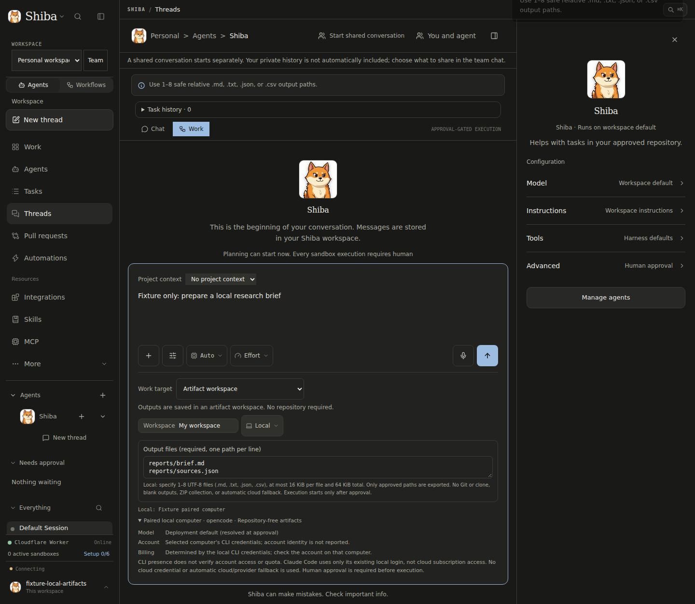

# PR188: paired local artifact increment

This is a bounded follow-up to the [six-feature checkpoint](pr188-six-features-20261105.md),
not completion of all six features or a deployed release.

## Integration handoff

- Source: `7a96effab47d56820ae24f2c869d7d70eb1709f2` on
  `feat/prince-multi-agent-control-plane` (application parent `22f790cf`).
- Derived branch: `feat/prince-multi-agent-control-plane--local-artifacts`.
- Ordered code commits: `075be6a` (intake/approval/export), `55a1e4a`
  (runtime/daemon security fences), `e671046` (composer/disclosures).
- Only the derived branch is published. No new PR, shared-branch update,
  merge, deployment, managed preview, paid inference or live provider test.
- Intended coordinator: `thr_54fca85da69a4da4b7031ff85cbdb5b1`. Cross-thread messaging is unavailable
  in this task; this document and the branch are the handoff.

## Supported scope

The dashboard Work composer admits repository-free work for an authenticated
self-hosted operator, on an explicitly selected paired computer, using
OpenCode, Claude Code or Codex. The frozen approval includes runtime, device
and explicit output paths. No dispatch or sandbox starts before approval.

Only 1–8 explicit UTF-8 `.md`, `.txt`, `.json` or `.csv` files are exported:
16 KiB per file and 64 KiB total. The local path does not clone a repository,
invoke Git, collect a ZIP, publish a PR or fall back to cloud/provider execution.
Local Claude Code uses only its existing local CLI login; pairing and CLI
presence do not prove account access, quota or billing identity.

Dispatch and claims require the pinned paired computer; result/control traffic
cannot use another machine or the shared operator token alone. Revocation
invalidates pending and claimed artifact records. Transactional writes prevent
late claim traffic from resurrecting revoked work. Durable tombstones prevent
reusing artifact IDs even after terminal audit records are pruned or when
relabelled as repository work. Uncertain dispatch/status transport, timeout and
post-claim cancellation retain unknown-outcome classification, not automatic retry.

Downloads remain private to the owning authenticated session; foreign owners
and revoked sessions cannot export them. Artifact hashes and byte bounds are
verified before persistence/export. The explicit manifest excludes other files.

## Deliberately unavailable

- Team and personal-account local artifacts: deployment-wide operator pairing
  is not an owner/workspace-bound execution grant. Intake, adapter and dispatch
  reject team-scoped artifacts; personal repository grants cannot authorize them.
- Native cloud Claude login: no approved credential-forwarding design; no
  bearer/refresh token or `auth.json` is mounted in a sandbox.
- Chat/delegated local artifact tools: fail with a dashboard-composer instruction,
  rather than silently changing to sandbox execution.
- This does not complete Slack, online shared-computer, funding, recovery or
  founder-report acceptance described in the six-feature checkpoint.

## Local verification

- Eight focused backend suites: **323 passed** after the owner/device fixture
  updates. Initial integration had three fixture failures because those fields
  were absent; assertions were retained and the fixtures gained explicit authority.
- After the final cancellation fix, local-runtime and local-artifact-pipeline:
  **97 passed**, including observed/retained claims and never-claimed cancellation.
- Actual-daemon fixtures use local fake executables, not provider inference.
  They cover adapter → pinned dispatch → claim/result → verification → private
  persistence, no Git, excluded files, replay, revocation and prelaunch failure.
  Separate HTTP fixtures cover approval and owner/revoked-session export fences;
  these are not a single live end-to-end provider journey.
- Full frontend suite: **1,226 passed across 152 files**.
- Root typecheck, lint, import lint, `check:ci`, build and five built-site tests
  passed. Existing lint/knip and build warnings remain; passing is not warning-free.
- Personal native daemon checks: **51 passed**, using fixture processes only.
- Docs diagnostics passed (165 files, zero errors/warnings/hints), and
  deploy-configuration checks passed (seven tests plus drift/environment checks).
- Full workspace `pnpm test` is still running at this documentation checkpoint;
  it is not yet a green claim.
- No GitHub Actions run exists for the published code head at this checkpoint.
  CI is label-triggered (`build:validate`), not push-triggered; exact integrated
  head CI remains the coordinator's merge gate. No full Desktop success is claimed.

## Browser evidence

Chromium ran against a separate loopback Vite server with backend HTTP/WebSocket
fixtures. Verified selecting Artifact workspace → Local, blocking blank paths
for click/shortcut, submitting one repo-free request with device/paths, and
blocking submission after device revocation without fallback. The agent observed
zero non-loopback requests. Screenshot was visually inspected by both the UI
agent and coordinator; it contains fixture data only. The temporary server stopped.

